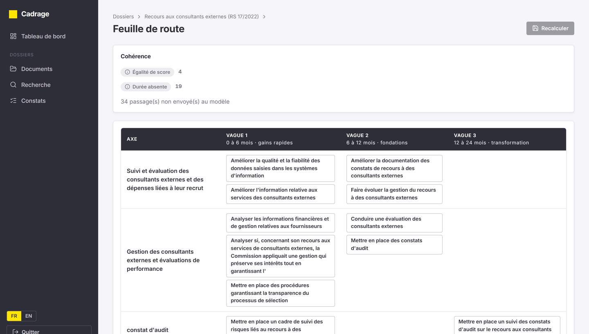
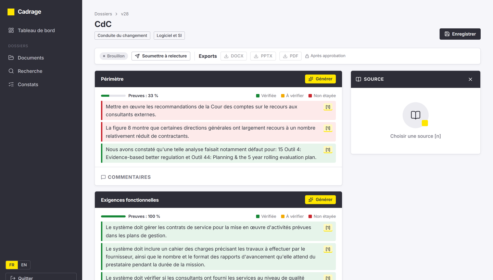
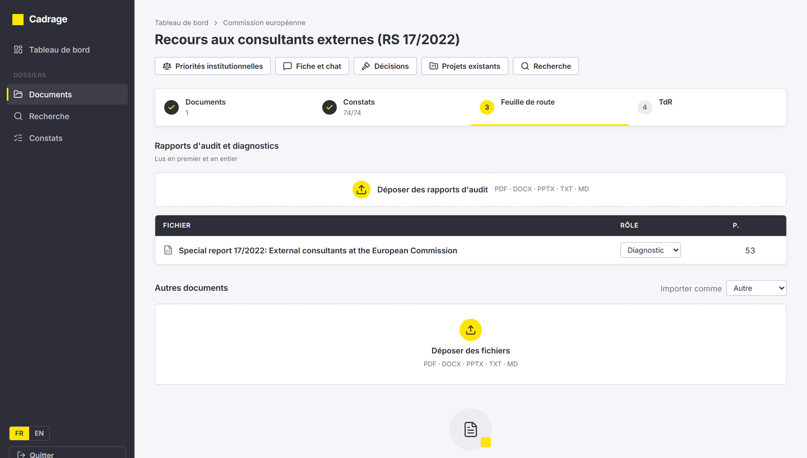
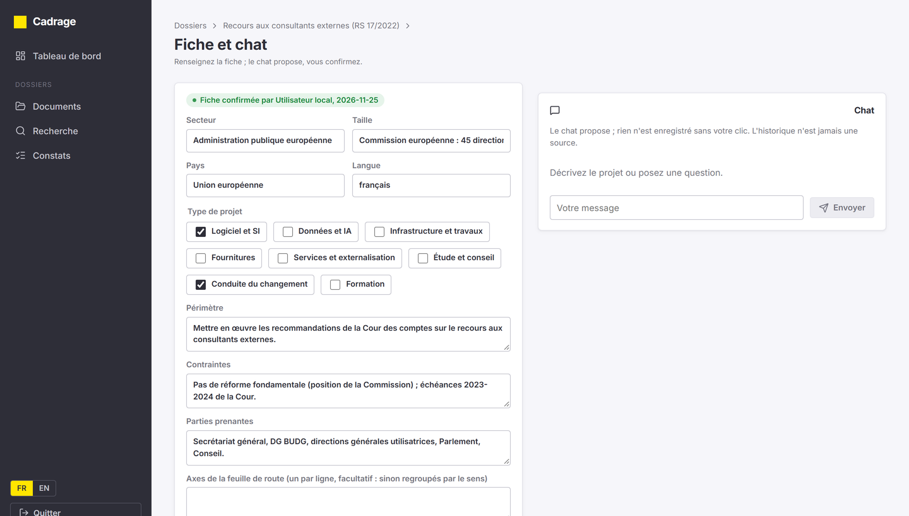
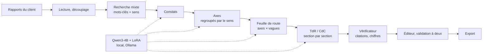
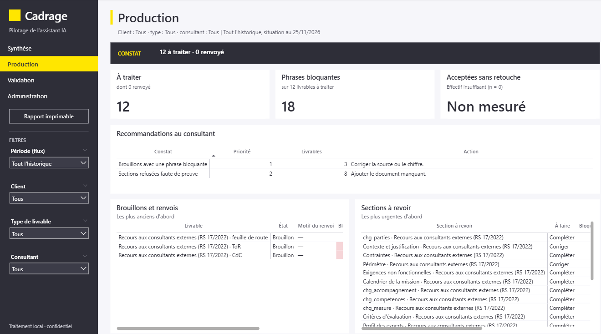

# Cadrage — IA locale qui transforme des rapports d'audit en feuille de route, TdR et cahier des charges

> **In short (EN).** Cadrage reads a client's audit and diagnostic reports and drafts a roadmap organised by axes and
> waves, terms of reference and a specification. Every sentence cites its source passage and is checked by a
> verifier; without evidence the tool refuses instead of inventing. It runs 100 % on-premise with an open-weight
> model (Qwen3-4B, fine-tuned with QLoRA on public audit reports): no cloud, no API, no client data leaves the server.
> A consultant reviews and edits, a manager approves, then it exports to Word, PowerPoint or PDF.

**Un consultant dépose les rapports d'un client ; Cadrage en tire les constats, les range en axes, propose une feuille
de route datée par vagues et rédige termes de référence et cahier des charges. Chaque phrase cite sa source et passe
par un vérificateur. Tout tourne sur le serveur du client.**

Projet de fin d'études, 2026. Testé sur un vrai rapport public : rapport spécial 17/2022 de la Cour des comptes
européenne (53 pages, CC BY 4.0).

| Feuille de route par axes et par vagues | Cahier des charges : exigences citées et vérifiées |
|---|---|
|  |  |
| **Dossier : rapports d'audit lus en premier** | **Fiche de contexte et chat (axes imposés possibles)** |
|  |  |

## Ce que fait l'outil

1. **Lit** les documents du dossier (PDF, DOCX, PPTX, texte ; français et anglais) et repère les consignes cachées.
2. **Extrait les constats**, avec gravité et source (74 constats en 15 min sur le rapport de 53 pages).
3. **Range les constats en axes** (gouvernance, données, contrats…), comme un cabinet de conseil : le code regroupe
   par le sens, le modèle nomme chaque axe ; le consultant peut aussi imposer ses axes.
4. **Propose les initiatives axe par axe**, les classe (impact, urgence, faisabilité, coût, risque) et les répartit en
   vagues : 0-6 mois (gains rapides), 6-12 mois (fondations), 12-24 mois (transformation).
5. **Rédige TdR et cahier des charges section par section**, uniquement à partir des passages retrouvés ; les sections
   qui exigent une décision humaine (budget, profil, calendrier) attendent cette décision. Sur demande, il **propose
   quand même** une section en citant constats et recommandations.
6. **Vérifie chaque phrase** (la source existe ? le chiffre y figure ?) et la colore dans l'éditeur ; **validation à
   deux** (consultant, puis responsable), versions, audit, exports Word / PowerPoint / PDF, tableau de bord Power BI.



## Ce que montre ce projet

- **RAG « preuve d'abord »** : recherche hybride BM25 + vecteurs bge-m3, filtre de pertinence, refus explicite sans
  preuve, vérificateur de citations et de chiffres. Aucune coupe silencieuse du contexte : si ça ne tient pas, l'outil
  le dit.
- **Fine-tuning mesuré, pas supposé** : QLoRA de Qwen3-4B sur des rapports publics, test sur des rapports jamais vus,
  puis test dans l'application, puis sur un vrai rapport. Arrêt anticipé, meilleure version exportée, comparaison
  honnête avec le modèle de base passé par la même chaîne.
- **Ingénierie sous contrainte** : un GPU de 4 Go et une fenêtre de 4 096 jetons ; un vrai rapport (74 constats) passe
  en découpant le travail par axes, avec des réponses bornées et des parties ratées reprises automatiquement.
- **Le code et le modèle à leur place** : le code range, contrôle et calcule (fiable) ; le modèle lit et rédige.
- **Produit complet** : FastAPI, Next.js, PostgreSQL + pgvector, validation à deux, audit, exports, entrepôt de données
  et Power BI, déploiement Docker hors ligne ; 738 tests backend, 130 tests d'entraînement, 42 tests d'interface.

## Résultats mesurés

**Modèle entraîné contre modèle de base** (169 exemples de rapports jamais vus à l'entraînement) :

| Tâche | Base | Entraîné |
|---|---|---|
| Choisir entre répondre et refuser | 114/169 | **168/169** |
| Refuser quand rien ne le permet | 4/31 | **31/31** |
| Extraire les constats | 3/31 | **31/31** |
| Lire la position de l'institution (accepte / partiellement / rejette) | 46/50 | **50/50** |
| Détecter un conflit avec une stratégie | 11/24 | 11/24 (point faible) |

**Dans l'application** (31 sections) : sections sans preuve rédigées quand même 40 % → **10 %** ; citations et chiffres
fidèles 97-99 % → **100 %** ; temps par section (p95) 37 s → **24 s**.

**Sur le vrai rapport** (portable, GTX 1650 4 Go) : 74 constats en 15 min ; feuille de route en 22 min, 6 axes de 9 à
16 constats, 19 initiatives, aucun constat oublié ; contexte des TdR rédigé et vérifié à 100 % ; 12 exigences
fonctionnelles proposées, toutes vérifiées.

## Tableau de bord du consultant (Power BI)

Un entrepôt de données (schéma en étoile, sans aucun texte client) alimente un rapport Power BI par acteur. Ci-dessous,
la page du **consultant**, chargée avec les **vraies données** de l'application après le travail sur le rapport de la
Cour (25/11/2026) : 12 livrables à traiter, 18 phrases à corriger (source ou chiffre non vérifié), les sections à
compléter et, pour chaque problème, l'action conseillée. Le taux d'acceptation sans retouche reste « non mesuré » tant
qu'aucun livrable n'a été validé : le rapport n'invente pas de chiffre.



Indicateurs et formules : [`bi/KPI.md`](bi/KPI.md) ; autres pages (responsable, administration) : [`bi/README.md`](bi/README.md).

## Entraînement

| Essai | Où | Données | Durée d'entraînement | Résultat |
|---|---|---|---|---|
| 1 (23/11) | Colab, GPU T4 | 33 exemples | quelques minutes (25 pas) | réponses vides : format des réponses différent de celui imposé par Ollama ; non adopté |
| **v4** (24/11) | Colab, GPU T4 | 341 exemples | **21 min** | meilleure version au pas 80 ; **adopté** |
| v5 (25/11) | Kaggle, GPU T4 | 441 exemples (dont 100 « axes ») | **43 min** | équivalent à v4 ; v4 gardé |

Au total : **~1 h 05 d'entraînement**, environ **6 h de GPU gratuit** en comptant préparation, exports et tests
(estimation). Données : 675 exemples tirés de rapports publics de la Cour des comptes européenne 2023-2026 (licence
CC BY 4.0), découpés **par rapport** entre entraînement, validation et test. Tout est expliqué simplement, pas à pas :
[`docs/20-comprendre-l-apprentissage.md`](docs/20-comprendre-l-apprentissage.md).

## Limites (mesurées)

- **Matériel** : sur un GPU de 4 Go, un tiers du modèle tourne sur le processeur ; une feuille de route de 74 constats
  prend ~22 min et le GPU chauffe (85-91 °C).
- **Conflits** recommandation / stratégie mal détectés (11 sur 24) : trop peu d'exemples à l'entraînement.
- **Axes** : bien rangés par le code, mais noms parfois longs ou génériques ; certains titres d'initiative maladroits.
- **Cahier des charges** : un rapport d'audit ne contient pas d'exigences ; sans exigences du consultant, l'outil
  refuse ou propose un premier jet inégal (exigences fonctionnelles utilisables, le reste à reformuler).
- **Horizons** indicatifs (vagues), pas encore de dates réelles ni de sprints.
- Le taux de phrases vérifiées mesure l'**ancrage** dans les sources, pas la vérité : la relecture humaine reste
  obligatoire.

## Matériel conseillé

| Usage | Matériel | Effet |
|---|---|---|
| Développement (mesuré) | portable, GTX 1650 4 Go, 16 Go de RAM | fonctionne ; ~22 min par feuille de route |
| Poste d'un consultant | GPU 16 Go (ex. RTX 4070 Ti Super / 4080), 32 Go de RAM | modèle entier sur GPU, fenêtre 8 000-16 000 jetons : quelques minutes (estimation) |
| Serveur d'équipe | GPU 24-48 Go (ex. L4, L40S, RTX 6000 Ada), vLLM | plusieurs consultants, modèle 8-14B, fenêtre 32 000 jetons (estimation) |
| Entraînement | 1 GPU 16-24 Go pour QLoRA d'un modèle 4B (mesuré sur T4 16 Go) ; 48-80 Go pour 8-14B | entraînement sur site, sans Colab ni Kaggle |

## Prochaines étapes

Détail, ordre et méthode : [`docs/21-vision-et-prochaines-etapes.md`](docs/21-vision-et-prochaines-etapes.md).

1. **Capter chaque correction** du consultant (texte modifié, référence fausse, section refusée puis forcée, consigne
   de chat), datée et horodatée, en double lecture : journal lisible par un humain et JSONL prêt pour l'entraînement.
2. **Comptes et espace d'administration** : un historique par consultant ; un responsable voit tout, nettoie les
   données avec l'aide de l'IA (doublons, corrections douteuses signalées).
3. **Entraîner depuis ces données**, sur un serveur interne ou sur Kaggle, d'un clic : export, entraînement, test
   comparatif, adoption seulement si le nouveau modèle fait mieux.
4. **Feuille de route datée** (mois, sprints) depuis une date de départ et des durées ; **CdC sur sommaire importé**,
   consignes par section (« améliore la section X avec le document Y »).
5. **Contrôle du diagnostic** avant usage (documents manquants, incohérences), au choix du consultant.

## Démarrer (Windows, PowerShell)

Prérequis : Python 3.12, Node 22. Sans modèle, un modèle de démonstration cite de vraies phrases des documents.

```powershell
cd backend ; py -3.12 -m venv .venv ; .venv\Scripts\python -m pip install -e . reportlab
```
```powershell
$env:AUTH_MODE="dev" ; $env:LLM_PROVIDER="demo" ; .venv\Scripts\python -m uvicorn app.main:app --port 8000
```
```powershell
cd ..\frontend ; npm install ; npm run dev
```

Ouvrir http://localhost:3000. Avec le vrai modèle : installer Ollama, importer le modèle entraîné
(`python -m training.import_ollama`, voir [`training/README.md`](training/README.md)) ou `ollama pull qwen3:4b`, puis
`ollama pull bge-m3` et `LLM_PROVIDER=ollama` (voir `.env.example`, dont `OLLAMA_PROPOSAL_MODEL`).

## Pile technique

Python 3.12 · FastAPI · SQLAlchemy · PostgreSQL + pgvector · Ollama · Qwen3-4B + QLoRA (PEFT, bitsandbytes) · bge-m3 ·
llama.cpp (GGUF Q4_K_M) · Next.js 15 · TipTap · Playwright · python-docx / python-pptx / LibreOffice · entrepôt en
étoile + Power BI · Docker Compose hors ligne.

## Documentation

| Document | Contenu |
|---|---|
| [`docs/STATUS.md`](docs/STATUS.md) | état d'avancement, ce qui reste |
| [`docs/20-comprendre-l-apprentissage.md`](docs/20-comprendre-l-apprentissage.md) | l'entraînement expliqué simplement |
| [`docs/19-entrainement-et-tests-reels.md`](docs/19-entrainement-et-tests-reels.md) | mesures détaillées, vrai rapport, fenêtre de contexte |
| [`docs/21-vision-et-prochaines-etapes.md`](docs/21-vision-et-prochaines-etapes.md) | vision cible, apprentissage par les corrections, plan |
| [`docs/01-cahier-des-charges.md`](docs/01-cahier-des-charges.md) · [`docs/06-architecture.md`](docs/06-architecture.md) | besoin, exigences, architecture |
| [`docs/lots/AXES.md`](docs/lots/AXES.md) · [`docs/lots/`](docs/lots/) | comptes rendus techniques |
| [`bi/README.md`](bi/README.md) | entrepôt, indicateurs, Power BI (valeurs de démonstration) |

**Principes** : 100 % local · preuve d'abord · validation à deux personnes · aucune donnée client dans le dépôt
(corpus public sous licence ouverte uniquement).
