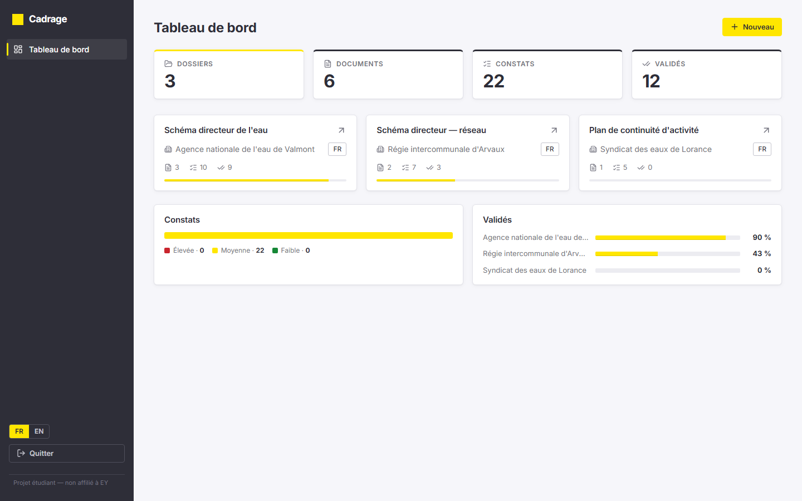
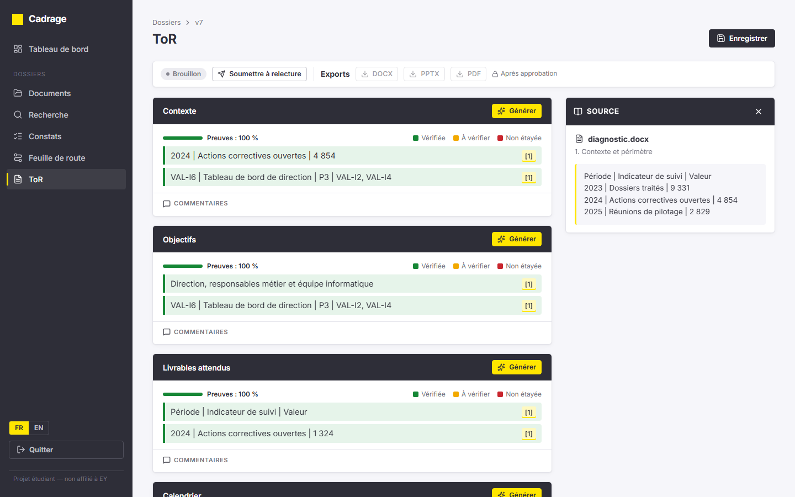
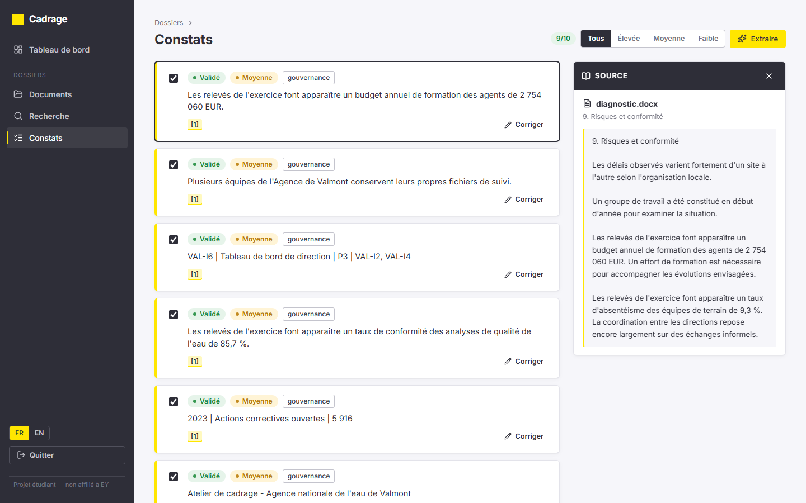
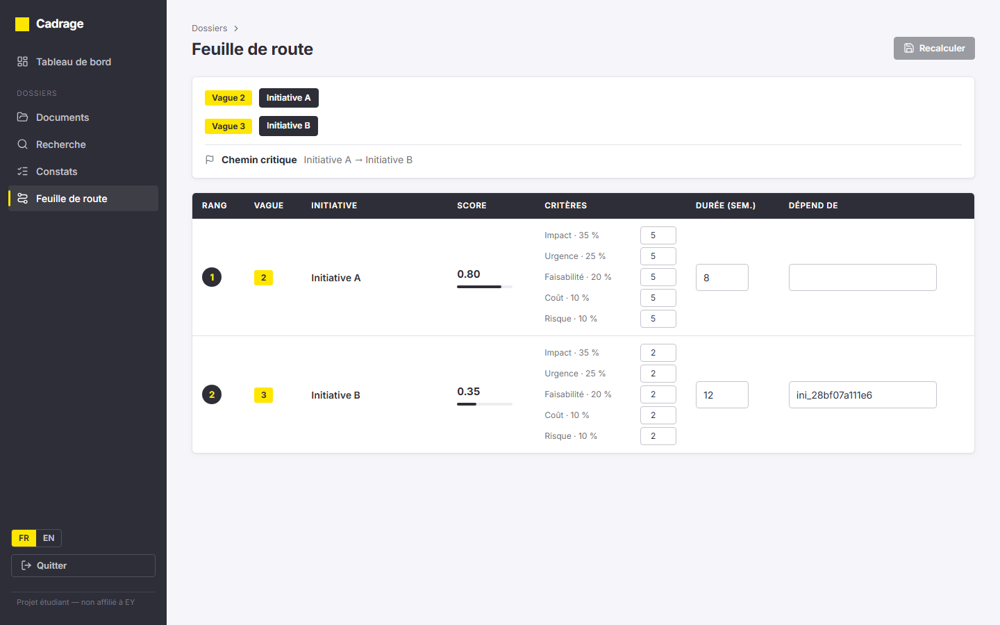
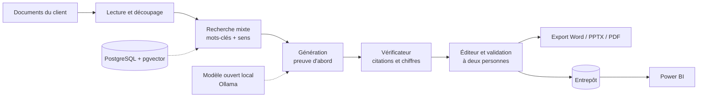
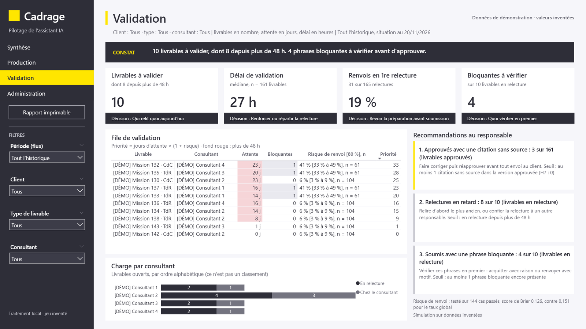

# Cadrage — assistant IA local pour feuilles de route, termes de référence et cahiers des charges

> **In short (EN).** Cadrage drafts roadmaps, terms of reference and specifications from a client's diagnostic documents. Every sentence cites its source, and a checker blocks unknown citations and flags figures absent from the cited evidence (it does not prove that a source supports the sentence). Everything runs on the client's own server with an open-weight model: no cloud, no API. A consultant reviews and edits, a manager approves (two different people), then the deliverable is exported to Word, PowerPoint or PDF. Works in French and English; runs on a real local model (Qwen3 4B); first quality measurements are being redone after a context-truncation bug.

**À partir d'un diagnostic confidentiel, Cadrage prépare un premier jet cité et vérifié, que le consultant relit, corrige et fait valider.**

Projet étudiant — non affilié à EY. Sujet : *Stages & PFE Book 2026-2027*, p. 92, Réf. #TST 11.

| | |
|---|---|
|  |  |
|  |  |

## Ce que fait l'outil

- **Lit** les documents d'un dossier client (PDF, DOCX, PPTX, texte), en français et en anglais, et repère les consignes cachées connues dans les documents (une détection par motifs, pas une garantie).
- **Rédige** constats, feuille de route priorisée, termes de référence et cahier des charges, **section par section**, uniquement à partir des passages retrouvés : sans preuve, il refuse de répondre.
- **Vérifie** chaque phrase : la source citée existe-t-elle, le chiffre figure-t-il dans le passage ? Dans l'éditeur, chaque phrase est colorée selon sa preuve, avec la source à côté.
- **Fait valider** à deux personnes (le consultant rédige, le manager approuve), garde l'historique des versions et exporte en Word, PowerPoint ou PDF. Un entrepôt de données alimente un tableau de bord Power BI (usage, qualité, temps gagné).

## Architecture



## Chiffres

Mesurés sur un PC portable (GTX 1650, 4 Go de VRAM), modèle de génération **Qwen3 4B** (Apache 2.0) et embeddings **bge-m3** (MIT), tous deux exécutés localement.

| Mesure | Résultat | Nature |
|---|---|---|
| Corpus public | **103 documents** sous licence CC BY (Banque mondiale, Commission européenne), 82 EN / 21 FR, licences et SHA-256 tracés | réel |
| Jeu d'entraînement | 3 105 exemples générés par script : jeu **rejeté** le 22/11/2026 après lecture : réponses presque toutes recopiées des passages (2 061 sur 2 067), questions faites de mots-clés, 83 % en anglais, aucune feuille de route ni TdR ni cahier des charges | **non utilisable**, nouveau jeu à valider |
| Jeu or | **34 questions** rédigées par une IA, repères contrôlés par script, **non relues par un humain** (29 faits, 5 « sans preuve ») sur des documents jamais utilisés pour l'entraînement | réel |
| Latence par section | **21,7 s** (p50), 45,3 s (p95) ; modèle seul 20,8 jetons/s (GPU chaud) | réel, 31 sections, 23/11 ([R2](docs/lots/R2.md)) |
| Mémoire vidéo | **3,1 Go** de pic sur 4 Go | réel |
| Rappel@10 de la recherche (bge-m3 + BM25) | **1,000** | réel, 1 institution, 31 sections, 23/11 : petit échantillon |
| Faux refus / refus manqués | **0 % / 0 %** avec la porte de pertinence (seuil 0,45) ; 0 % / **70 %** sans elle | réel, 10 sections par catégorie, 23/11 ; seuil calibré sur ce même corpus synthétique : à recalibrer sur corpus réel |
| PostgreSQL + pgvector, export PDF LibreOffice, parcours navigateur Playwright | exécutés et verts | réel |
| Tests | 654 backend, 34 entraînement, 34 interface (23/11) | automatisés |
| Rappel@10, 23/23 erreurs détectées, TPV 0,85 du banc d'évaluation | | **simulé** (corpus fictif, faux modèle) : valide la mécanique, pas la qualité |
| Entraînement LoRA (modèle « C ») | | **à faire** (T5) |
| Valeurs du tableau de bord Power BI | | **inventées** (démonstration) |

> **Remesuré le 23/11/2026** après le correctif de contexte ([R2](docs/lots/R2.md)) : 1 attaque par consigne cachée sur 5 a été suivie par le modèle (signalée et non approuvable), et le GPU monte à 91 °C.

Le TPV (taux de phrases vérifiées) mesure l'ancrage dans les sources, pas la vérité : il ne remplace pas la relecture humaine. Détails et limites : [`docs/lots/T2.md`](docs/lots/T2.md), [`docs/lots/T4.md`](docs/lots/T4.md).

## Tableau de bord Power BI

Un rapport pour les deux acteurs de l'application, le **consultant** qui rédige et le **responsable** qui valide : constat, recommandations par règles, prédiction testée contre une référence naïve, rapport PDF. Les valeurs affichées sont **inventées** (jeu de démonstration).

| Synthèse | Validation |
|---|---|
|  |  |

Qui voit quoi : [`docs/14`](docs/14-acteurs-dashboard.md). Indicateurs (formule, décision, cible, limite) : [`bi/KPI.md`](bi/KPI.md). Ouverture du projet et autres pages : [`bi/README.md`](bi/README.md).

## Démo en 3 commandes (Windows, PowerShell)

Prérequis : Python 3.12 et Node 22. Aucun modèle ni Docker : un modèle de démonstration cite de vraies phrases des documents.

```powershell
cd backend ; py -3.12 -m venv .venv ; .venv\Scripts\python -m pip install -e . reportlab
```
```powershell
$env:AUTH_MODE="dev" ; $env:LLM_PROVIDER="demo" ; .venv\Scripts\python -m uvicorn app.main:app --port 8000
```
```powershell
cd ..\frontend ; npm install ; npm run dev
```
Ouvrir http://localhost:3000. Avec un vrai modèle : installer Ollama, `ollama pull qwen3:4b` et `ollama pull bge-m3`, puis `LLM_PROVIDER=ollama` (voir `.env.example`). Tests : `cd backend ; .venv\Scripts\pytest -q`.

## Pile technique

Python 3.12 · FastAPI · SQLAlchemy · Alembic · PostgreSQL + pgvector (SQLite en test) · Ollama (Qwen3 4B, bge-m3) · Next.js 15 · TipTap · Playwright · python-docx / python-pptx / LibreOffice · entrepôt en étoile + Power BI · Docker Compose (réseau interne, hors ligne) · QLoRA (scripts prêts).

## Principes

- **100 % local** : aucun document ni aucune requête ne quitte le serveur du client ; pas d'API hébergée, l'API est coupée d'Internet dans le déploiement Docker.
- **Preuve d'abord** : pas de passage retrouvé, pas de phrase. Toute citation ou tout chiffre introuvable est rejeté.
- **Validation à deux** : le consultant rédige, le manager approuve, deux personnes distinctes ; chaque transition est tracée.
- **Aucune donnée client** dans le dépôt ni dans l'entrepôt : corpus public ou synthétique seulement.

## Aller plus loin

| Document | Contenu |
|---|---|
| [`docs/01-cahier-des-charges.md`](docs/01-cahier-des-charges.md) | besoin, exigences, hypothèses à valider |
| [`docs/06-architecture.md`](docs/06-architecture.md) | architecture, contrats, API |
| [`docs/07-entrepot-bi.md`](docs/07-entrepot-bi.md) · [`bi/README.md`](bi/README.md) | entrepôt, indicateurs, Power BI |
| [`docs/08-modele-rag-evaluation.md`](docs/08-modele-rag-evaluation.md) | modèles, recherche, vérification, évaluation, entraînement |
| [`docs/10-exploitation.md`](docs/10-exploitation.md) | installation hors ligne, sauvegarde, sécurité |
| [`docs/STATUS.md`](docs/STATUS.md) | état d'avancement et prochaines étapes |
| [`docs/11-rapport-direction.md`](docs/11-rapport-direction.md) · [`docs/12-journal-orchestration.md`](docs/12-journal-orchestration.md) | rapport et journal de construction |
| [`docs/lots/`](docs/lots/) | comptes rendus de chaque lot |
| [`docs/03-apprentissage-et-glossaire.md`](docs/03-apprentissage-et-glossaire.md) | glossaire en français simple |

```
backend/   API, génération, vérification, export, entrepôt, évaluation
frontend/  interface Next.js        training/  jeu d'entraînement, scripts LoRA
bi/        Power BI (PBIP, thème)   deploy/    Docker, hors ligne, sauvegarde
data/      corpus public et licences   docs/    documentation
```
