# Cadrage — IA locale qui transforme des rapports d'audit en feuille de route, TdR et cahier des charges

> **In short (EN).** Cadrage reads a client's audit and diagnostic reports and drafts a roadmap organised by axes and
> waves, terms of reference and a specification. Every sentence cites its source passage and is checked by a
> verifier; without evidence the tool refuses instead of inventing. It runs 100 % on-premise with an open-weight
> model (Qwen3-4B, fine-tuned with QLoRA on public audit reports): no cloud, no API, no client data leaves the server.
> A consultant reviews and edits, a manager approves, then it exports to Word, PowerPoint or PDF.

**Un consultant dépose les rapports d'un client ; Cadrage en tire les constats, les range en axes, propose une feuille
de route datée par vagues et rédige termes de référence et cahier des charges. Chaque phrase cite sa source et passe
par un vérificateur. Tout tourne sur un serveur local.**

Projet de fin d'études, 2026. Testé sur un vrai rapport public : rapport spécial 17/2022 de la Cour des comptes
européenne (53 pages, CC BY 4.0).

> [!IMPORTANT]
> ## 👉 [Voir le parcours complet en images, relu par un expert](docs/24-parcours-en-images.md)
> Du rapport d'audit au cahier des charges, étape par étape : ce que fait l'IA, ce qui est juste, ce qui est faux.

## Le parcours en 11 étapes

Test réel du 27-28/11/2026 sur un document public : le **rapport spécial 17/2022 de la Cour des comptes européenne**,
« Le recours de la Commission européenne à des consultants externes » (53 pages, licence CC BY 4.0).

### Étape 1 — Le tableau de bord
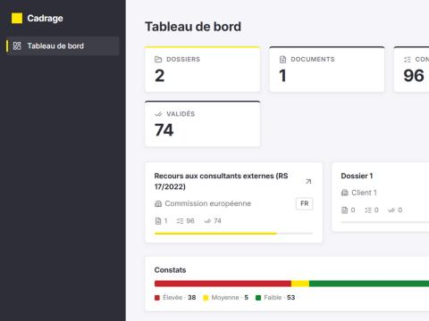
On commence ici : un dossier par client et par mission. On en crée un, « Test V4.1 », pour tester la dernière
version de l'application.

### Étape 2 — Le dossier et son rapport
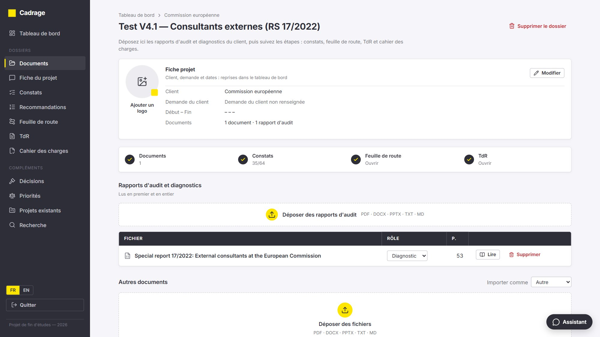
On dépose le rapport d'audit du client. Les étapes en haut montrent où en est le travail : documents, constats,
feuille de route, TdR.

### Étape 3 — L'IA lit le rapport, en direct
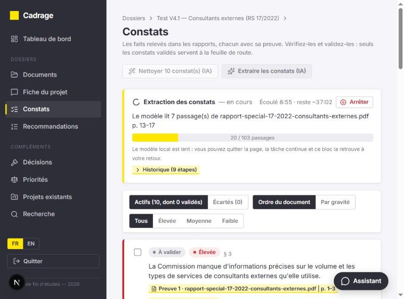
Le modèle lit les 103 passages du rapport : environ **36 minutes** sur un petit GPU de 4 Go. On voit ce qu'il fait,
le temps restant, et on peut l'arrêter.

### Étape 4 — Les constats : 35 gardés sur 64
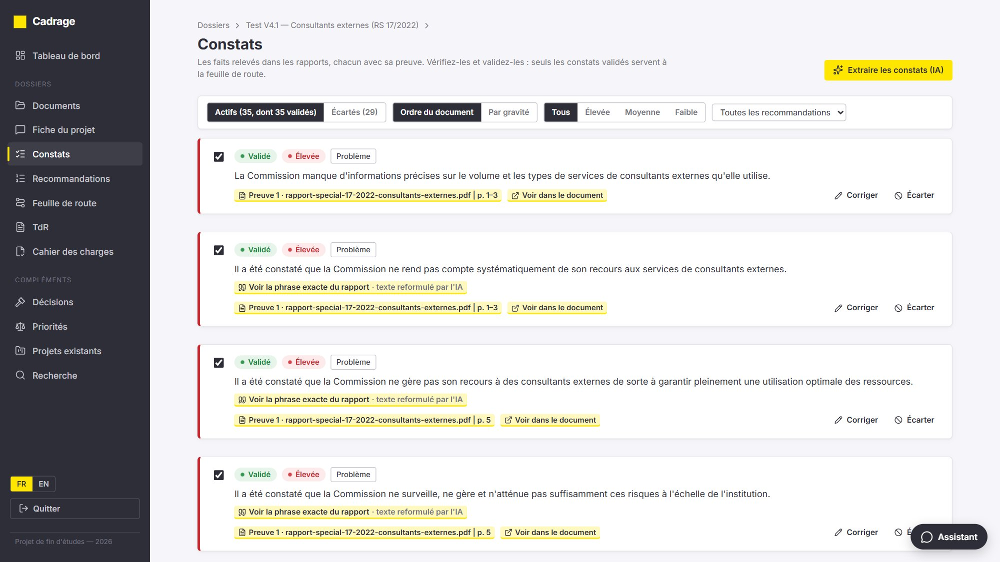
L'IA a relevé **64 phrases** du rapport. **29 n'étaient pas des constats** (méthode de l'audit, figures, contexte) :
27 écartées automatiquement, 2 par le consultant. Restent **35 constats validés**, après **6 corrections** du consultant.

### Étape 5 — Les recommandations du rapport
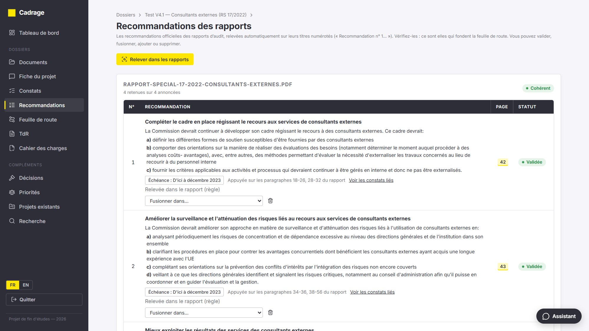
Les recommandations officielles sont reprises **en entier** : sous-points, échéance, paragraphes qui les justifient.
Comparé au rapport : **4 sur 4, aucune erreur**.

### Étape 6 — Chaque preuve, surlignée dans le document
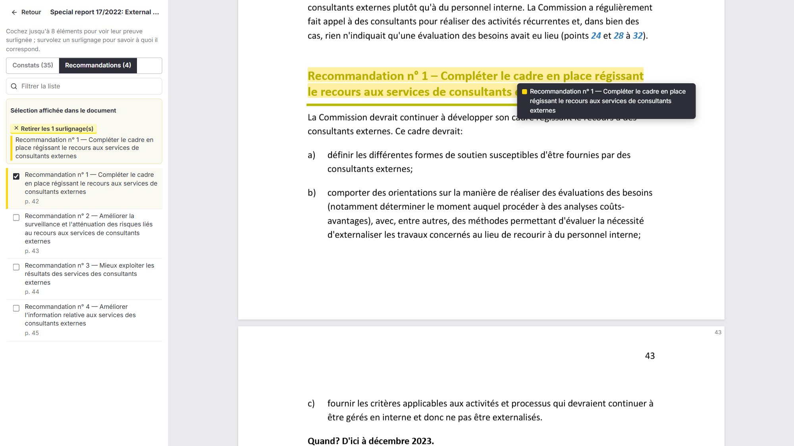
Chaque constat et chaque recommandation s'ouvre dans le PDF, à la bonne page, surligné. Au survol, une bulle dit à
quoi correspond le passage.

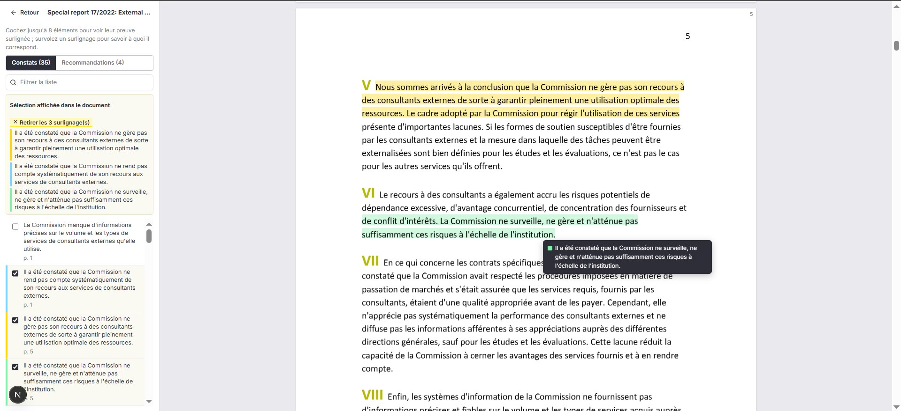
Un constat **reformulé par l'IA** : un clic ouvre le rapport à la phrase d'origine, surlignée. L'expert vérifie en
quelques secondes que le constat existe bien et que la reformulation est fidèle.

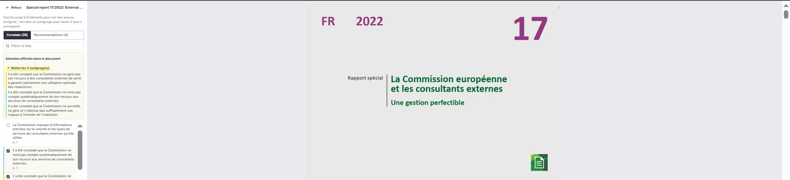
Le document testé, affiché dans l'application : rapport spécial 17/2022 de la Cour des comptes européenne
(© Union européenne, CC BY 4.0 ; logo de la Cour non reproduit).

### Étape 7 — La feuille de route
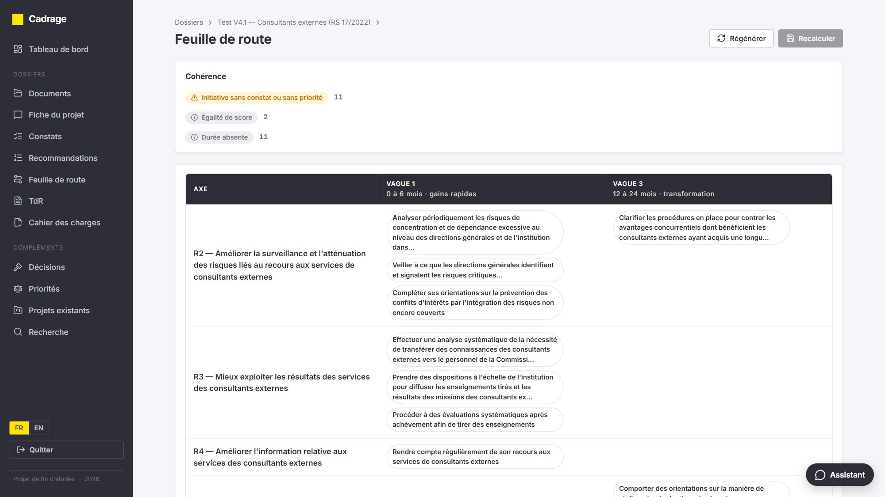
Chaque recommandation devient un **axe**, chaque sous-point une **initiative**, rangée en **vague** : 0-6 mois,
6-12 mois ou 12-24 mois. Calculée en 20 secondes, sans IA.

### Étape 8 — Pourquoi cette vague
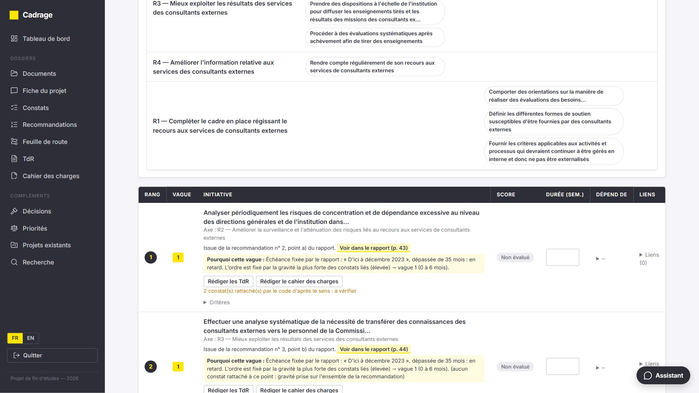
Chaque placement est expliqué (échéance du rapport, gravité des constats) et renvoie au rapport. Limite : la
recommandation n° 1 part en vague 3, car l'IA a mal jugé la gravité de ses constats.

### Étape 9 — Les termes de référence (TdR)
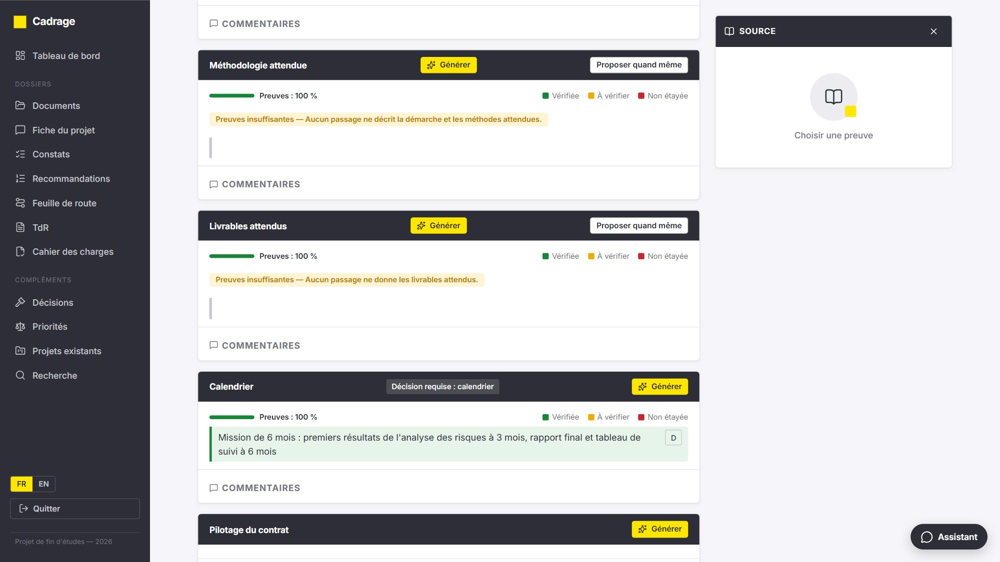
Les décisions du consultant (calendrier, profil, critères) sont reprises telles quelles. Sans preuve, l'IA
**refuse au lieu d'inventer** — parfois à tort : ici, les objectifs étaient dans la recommandation.

### Étape 10 — Le cahier des charges
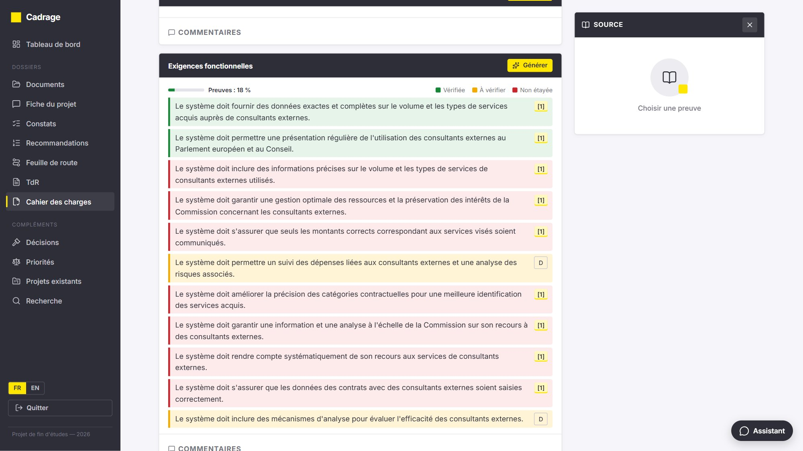
Chaque exigence est colorée selon sa preuve : vert vérifiée, rouge non étayée. Ici **2 sur 11 vérifiées** : le
premier jet de l'IA est à reprendre par le consultant.

### Étape 11 — L'assistant, sur toutes les pages
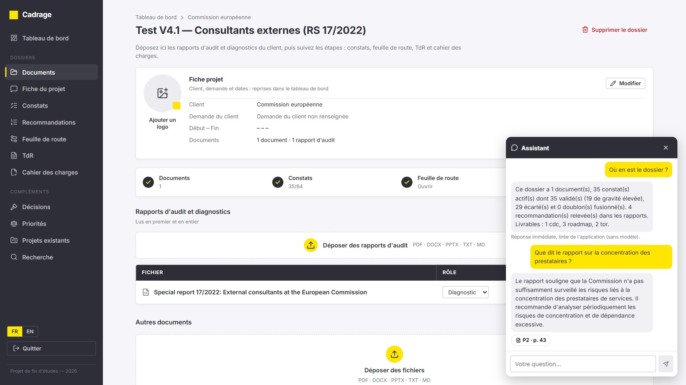
Il répond tout de suite sur l'état du dossier, et sur le contenu du rapport avec sa source (ici p. 43). Il ne
modifie rien dans le dossier.

## Ce que fait l'outil

1. **Lit** les documents du dossier (PDF, DOCX, PPTX, texte ; français et anglais), repère les consignes cachées, et
   les affiche dans l'application, **preuves surlignées**.
2. **Relève les recommandations** du rapport, en entier et par règles : sous-points, échéance, paragraphes cités.
3. **Extrait les constats** (phrases exactes du rapport, vérifiées), les **nettoie** (phrases de méthode écartées,
   doublons fusionnés, reformulation « Il a été constaté que… » à relire) et relie chacun à sa recommandation.
4. **Construit la feuille de route** : une recommandation = un axe, un sous-point = une initiative, la vague fixée
   par l'échéance du rapport ou la gravité, **raison écrite** ; sans recommandation, les constats sont regroupés
   par le sens.
5. **Rédige TdR et cahier des charges section par section**, uniquement à partir des sources ; les sections qui
   exigent une décision humaine (budget, profil, calendrier) la reprennent telle quelle ; sinon il refuse, ou
   **propose** un premier jet à relire.
6. **Vérifie chaque phrase** (la source existe ? le chiffre y figure ?) ; tâches longues suivies en direct
   (arrêt possible), assistant sur toutes les pages, validation à deux, versions, exports Word / PowerPoint / PDF,
   tableau de bord Power BI.

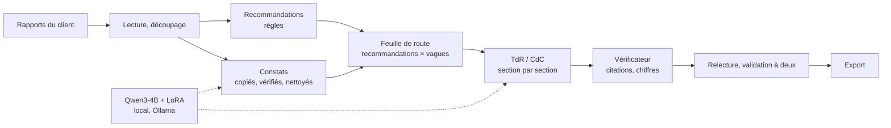

## Les livrables, en clair

| Livrable | Ce que c'est | Quand on s'en sert |
|---|---|---|
| **Feuille de route** | le plan d'action : des initiatives rangées par **axes** (gouvernance, données, contrats…) et par **vagues** dans le temps (0-6, 6-12, 12-24 mois), chacune reliée aux constats qui la justifient | pour décider quoi faire, dans quel ordre |
| **Termes de référence (TdR)** | la « fiche de mission » qu'on envoie pour **recruter un prestataire** (cabinet, expert) : contexte, objectifs, livrables attendus, profil recherché, calendrier, critères de choix | quand une initiative sera réalisée par quelqu'un d'extérieur, par exemple un audit de sécurité |
| **Cahier des charges (CdC)** | la description de **ce qu'il faut construire ou acheter** : périmètre, exigences fonctionnelles (« le système doit… ») et non fonctionnelles, contraintes, critères de recette | quand une initiative aboutit à un système, un service ou une fourniture |

**Types de cahier des charges et de TdR** : une base commune, complétée par des sections propres au type de projet
choisi dans la fiche de contexte, cumulables :

| Type de projet | Sections ajoutées (exemples) |
|---|---|
| Logiciel et SI | compétences techniques, architecture et intégration, sécurité et données, maintenance et niveaux de service |
| Données et IA | données et qualité, performance du modèle, gouvernance, éthique et conformité |
| Infrastructure et travaux | site et existant, normes techniques, réception et garanties |
| Fournitures | spécifications, livraison et installation, garantie et service après-vente |
| Services et externalisation | pilotage du contrat, périmètre du service, niveaux de service et pénalités, réversibilité |
| Étude et conseil | méthodologie attendue, questions à traiter, restitution et validation |
| Organisation et conduite du changement | parties prenantes et impacts, plan d'accompagnement, mesure de l'adoption |
| Formation | profil des formateurs, public et besoins, programme, évaluation des acquis |

**Combien de temps** (mesuré sur un portable à GPU de 4 Go, rapport de 53 pages, test du 27-28/11/2026) :

| Étape | Durée |
|---|---|
| Import du rapport (découpage en 103 passages, vecteurs) | ~3 min |
| Relevé complet des recommandations (règles) | ~1 s |
| Lecture du rapport et extraction des constats | ~36 min (64 phrases) |
| Nettoyage des constats (reformulation, doublons, bruit) | ~25 min pour 53 constats |
| Feuille de route à partir des recommandations (sans modèle) | ~20 s |
| Feuille de route par le sens (rapport sans recommandations) | ~22 min (mesure V4.0, 74 constats) |
| Une section de TdR ou de CdC rédigée par le modèle | 40 s à 3 min |
| Une section qui reprend une décision humaine (profil, calendrier…) | instantané |
| Sur un GPU de 16 Go (modèle entier sur la carte) | quelques minutes pour tout le parcours (estimation, non mesuré) |

## Ce que montre ce projet

- **RAG « preuve d'abord »** : recherche hybride BM25 + vecteurs bge-m3, filtre de pertinence, refus explicite sans
  preuve, vérificateur de citations et de chiffres. Aucune coupe silencieuse du contexte : si ça ne tient pas, l'outil
  le dit.
- **Fine-tuning mesuré, pas supposé** : QLoRA de Qwen3-4B sur des rapports publics, test sur des rapports jamais vus,
  puis test dans l'application, puis sur un vrai rapport. Arrêt anticipé, meilleure version exportée, comparaison
  honnête avec le modèle de base passé par la même chaîne.
- **Ingénierie sous contrainte** : un GPU de 4 Go et une fenêtre de 4 096 jetons ; un vrai rapport (74 constats) passe
  en découpant le travail par axes, avec des réponses bornées et des parties ratées reprises automatiquement.
- **Le code et le modèle à leur place** : le code range, contrôle et calcule (fiable) ; le modèle lit et rédige.
- **Produit complet** : FastAPI, Next.js, PostgreSQL + pgvector, validation à deux, audit, exports, entrepôt de données
  et Power BI, déploiement Docker hors ligne ; 746 tests backend, 130 tests d'entraînement, 45 tests d'interface.

## Résultats mesurés

**Modèle entraîné contre modèle de base** (169 exemples de rapports jamais vus à l'entraînement) :

| Tâche | Base | Entraîné |
|---|---|---|
| Choisir entre répondre et refuser | 114/169 | **168/169** |
| Refuser quand rien ne le permet | 4/31 | **31/31** |
| Extraire les constats | 3/31 | **31/31** |
| Lire la position de l'institution (accepte / partiellement / rejette) | 46/50 | **50/50** |
| Détecter un conflit avec une stratégie | 11/24 | 11/24 (point faible) |

**Dans l'application** (31 sections) : sections sans preuve rédigées quand même 40 % → **10 %** ; citations et chiffres
fidèles 97-99 % → **100 %** ; temps par section (p95) 37 s → **24 s**.

**Sur le vrai rapport** (portable, GTX 1650 4 Go), V4.0 : 74 constats en 15 min ; feuille de route par le sens en
22 min, 6 axes, 19 initiatives. V4.1-4.2, relu en consultant expert : recommandations relevées **sans erreur**
(4/4, 11 sous-points, échéances, paragraphes) ; constats clés de la conclusion tous extraits ; reformulation ≈ 1
erreur de sens sur 20 ; TdR et cahier des charges encore faibles (voir Limites et
[`docs/24`](docs/24-parcours-en-images.md)).

## Dashboard Power BI

**Pour qui, pour quoi.** L'application sert à produire ; le tableau de bord sert à **piloter** : le consultant voit
quels rapports d'audit contrôler et quelles sections reprendre, le responsable sa file de relecture, la direction
l'activité et un rapport d'une page, le profil technique la qualité du modèle et ses entraînements. Power BI croise
**tous les projets sur toute la période**, avec des filtres combinables (données réelles ou de démonstration, période
au jour, mois, projet, client, consultant, type de livrable) et un encadré **« Que faire ensuite »** : 7 règles
explicites, dont les 3 premières qui se déclenchent s'affichent.

**Lien avec l'application** L'application écrit dans sa base ; un chargement (ETL : `python -m app.dw.etl`) copie ce qu'il faut 
dans un **entrepôt de données** (schéma en étoile, **aucun texte du client**), puis Power BI s'actualise à partir de cet entrepôt 
(export CSV, chemin testé ;
lecture directe PostgreSQL préparée, non testée). Les chiffres datent donc du **dernier chargement**, affiché en pied
de page. Une correction faite dans l'application (par exemple une recommandation ajoutée par le consultant) apparaît
au chargement suivant. Le projet de la Cour des comptes et les trois entraînements sont **réels** ; cinq projets
« [DÉMO] », signalés sur chaque visuel et masquables, montrent la comparaison entre projets sur plusieurs mois.

| Synthèse | Projet |
|---|---|
| 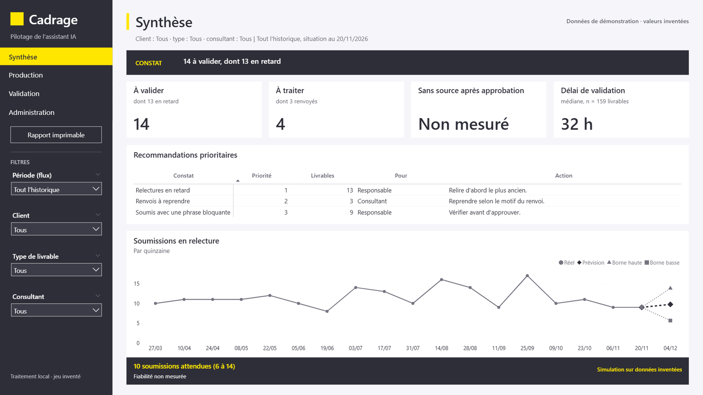 | 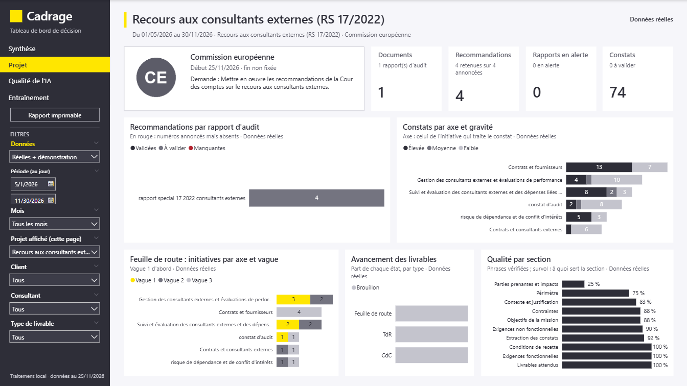 |
| **Qualité de l'IA** | **Entraînement** |
| 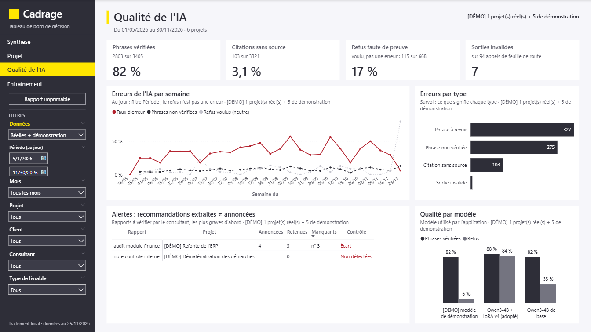 | 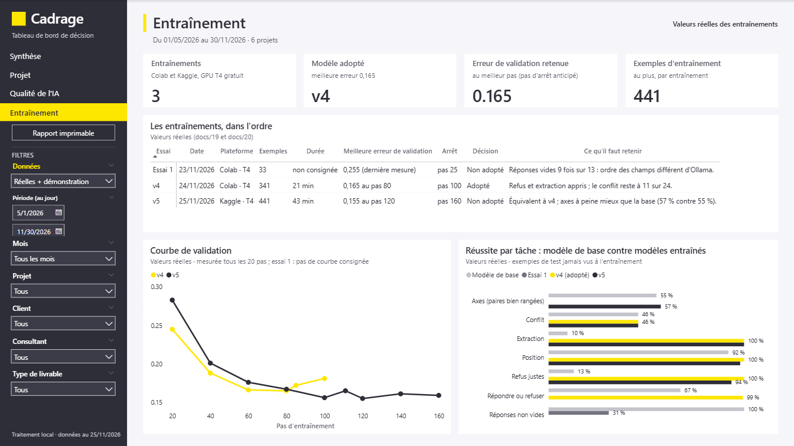 |

Tout le détail (chemin des données, dimensions et faits, modèle Power BI, mesures, règles, fraîcheur, limites) :
[`docs/22-business-intelligence.md`](docs/22-business-intelligence.md). Rapport imprimable : [`docs/img/powerbi-rapport.png`](docs/img/powerbi-rapport.png).

## Entraînement

| Essai | Où | Données | Durée d'entraînement | Résultat |
|---|---|---|---|---|
| 1 (23/11) | Colab, GPU T4 | 33 exemples | quelques minutes (25 pas) | réponses vides : format des réponses différent de celui imposé par Ollama ; non adopté |
| **v4** (24/11) | Colab, GPU T4 | 341 exemples | **21 min** | meilleure version au pas 80 ; **adopté** |
| v5 (25/11) | Kaggle, GPU T4 | 441 exemples (dont 100 « axes ») | **43 min** | équivalent à v4 ; v4 gardé |

Au total : **~1 h 05 d'entraînement**, environ **6 h de GPU gratuit** en comptant préparation, exports et tests
(estimation). Données : 675 exemples tirés de rapports publics de la Cour des comptes européenne 2023-2026 (licence
CC BY 4.0), découpés **par rapport** entre entraînement, validation et test. Tout est expliqué simplement, pas à pas :
[`docs/20-comprendre-l-apprentissage.md`](docs/20-comprendre-l-apprentissage.md).

## Limites (mesurées)

Relevées en refaisant tout le parcours en consultant expert (détail : [`docs/24`](docs/24-parcours-en-images.md),
[`docs/23` §4](docs/23-versions-de-l-application.md)) :

- **Gravité des constats peu fiable** : un même manque est « élevé » dans la synthèse, « faible » dans le corps du
  rapport ; elle fausse l'ordre des vagues (la recommandation de base peut partir en dernière vague).
- **Reformulation à relire** : avec garde-fous, ≈ 1 erreur de sens sur 20 (glissement, sens inversé) ; la phrase
  exacte du rapport reste affichée et sert de preuve.
- **TdR et cahier des charges** : le modèle entraîné refuse souvent les objectifs, livrables et exigences, même quand
  la recommandation les contient ; la proposition du modèle de base est inégale (répétitions, hors périmètre,
  sources mal attribuées), le vérificateur en marque la majorité « non étayée ».
- « Vérifiée » veut dire **copiée de la source**, pas lisible ni pertinente : une phrase abîmée par le PDF peut passer.
- **Matériel** : sur un GPU de 4 Go, la lecture d'un rapport de 53 pages prend ≈ 36 min, le nettoyage ≈ 25 min ;
  deux tâches du modèle en même temps se ralentissent.
- **Horizons** indicatifs (vagues), pas encore de dates réelles ni de sprints ; pas de dépendances entre
  recommandations.

## Matériel conseillé

| Usage | Matériel | Effet |
|---|---|---|
| Développement (mesuré) | portable, GTX 1650 4 Go, 16 Go de RAM | fonctionne ; ~22 min par feuille de route |
| Poste d'un consultant | GPU 16 Go (ex. RTX 4070 Ti Super / 4080), 32 Go de RAM | modèle entier sur GPU, fenêtre 8 000-16 000 jetons : quelques minutes (estimation) |
| Serveur d'équipe | GPU 24-48 Go (ex. L4, L40S, RTX 6000 Ada), vLLM | plusieurs consultants, modèle 8-14B, fenêtre 32 000 jetons (estimation) |
| Entraînement | 1 GPU 16-24 Go pour QLoRA d'un modèle 4B (mesuré sur T4 16 Go) ; 48-80 Go pour 8-14B | entraînement sur site, sans Colab ni Kaggle |

## Prochaines étapes

Détail, ordre et méthode : [`docs/21-vision-et-prochaines-etapes.md`](docs/21-vision-et-prochaines-etapes.md).

1. **Capter chaque correction** du consultant (texte modifié, référence fausse, section refusée puis forcée, consigne
   de chat), datée et horodatée, en double lecture : journal lisible par un humain et JSONL prêt pour l'entraînement.
2. **Comptes et espace d'administration** : un historique par consultant ; un responsable voit tout, nettoie les
   données avec l'aide de l'IA (doublons, corrections douteuses signalées).
3. **Entraîner depuis ces données**, sur un serveur interne ou sur Kaggle, d'un clic : export, entraînement, test
   comparatif, adoption seulement si le nouveau modèle fait mieux.
4. **Feuille de route datée** (mois, sprints) depuis une date de départ et des durées ; **CdC sur sommaire importé**,
   consignes par section (« améliore la section X avec le document Y »).
5. **Contrôle du diagnostic** avant usage (documents manquants, incohérences), au choix du consultant.

## Démarrer (Windows, PowerShell)

Prérequis : Python 3.12, Node 22. Sans modèle, un modèle de démonstration cite de vraies phrases des documents.

```powershell
cd backend ; py -3.12 -m venv .venv ; .venv\Scripts\python -m pip install -e . reportlab
```
```powershell
$env:AUTH_MODE="dev" ; $env:LLM_PROVIDER="demo" ; .venv\Scripts\python -m uvicorn app.main:app --port 8000
```
```powershell
cd ..\frontend ; npm install ; npm run dev
```

Ouvrir http://localhost:3000. Avec le vrai modèle : installer Ollama, importer le modèle entraîné
(`python -m training.import_ollama`, voir [`training/README.md`](training/README.md)) ou `ollama pull qwen3:4b`, puis
`ollama pull bge-m3` et `LLM_PROVIDER=ollama` (voir `.env.example`, dont `OLLAMA_PROPOSAL_MODEL`).

## Pile technique

Python 3.12 · FastAPI · SQLAlchemy · PostgreSQL + pgvector · Ollama · Qwen3-4B + QLoRA (PEFT, bitsandbytes) · bge-m3 ·
llama.cpp (GGUF Q4_K_M) · Next.js 15 · TipTap · Playwright · python-docx / python-pptx / LibreOffice · entrepôt en
étoile + Power BI · Docker Compose hors ligne.

## Documentation

| Document | Contenu |
|---|---|
| [`docs/STATUS.md`](docs/STATUS.md) | état d'avancement, ce qui reste |
| [`docs/20-comprendre-l-apprentissage.md`](docs/20-comprendre-l-apprentissage.md) | l'entraînement expliqué simplement |
| [`docs/19-entrainement-et-tests-reels.md`](docs/19-entrainement-et-tests-reels.md) | mesures détaillées, vrai rapport, fenêtre de contexte |
| [`docs/21-vision-et-prochaines-etapes.md`](docs/21-vision-et-prochaines-etapes.md) | vision cible, apprentissage par les corrections, plan |
| [`docs/23-versions-de-l-application.md`](docs/23-versions-de-l-application.md) | ce que fait chaque version (V4.0, V4.1, V4.2), revue experte, prochain entraînement |
| [`docs/24-parcours-en-images.md`](docs/24-parcours-en-images.md) | le parcours complet en captures, relu par un expert (erreurs comprises) |
| [`docs/22-business-intelligence.md`](docs/22-business-intelligence.md) · [`docs/07-entrepot-bi.md`](docs/07-entrepot-bi.md) | business intelligence : entrepôt, modèle Power BI, pages, règles |
| [`docs/01-cahier-des-charges.md`](docs/01-cahier-des-charges.md) · [`docs/06-architecture.md`](docs/06-architecture.md) | besoin, exigences, architecture |
| [`docs/lots/AXES.md`](docs/lots/AXES.md) · [`docs/lots/`](docs/lots/) | comptes rendus techniques |
| [`bi/README.md`](bi/README.md) | ouvrir et régénérer le rapport Power BI |

**Principes** : 100 % local · preuve d'abord · validation à deux personnes · aucune donnée client dans le dépôt
(corpus public sous licence ouverte uniquement).
