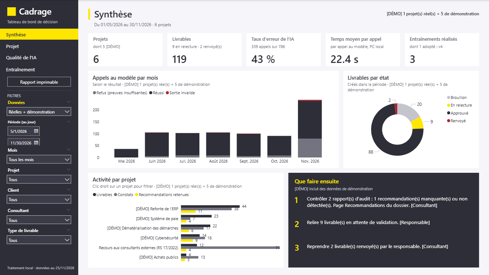

# Tableau de bord Power BI

Le rapport aide à **décider** : où en sont les projets, où l'IA se trompe, si l'entraînement a servi, et quoi faire
ensuite. Il complète l'application par ce qu'elle ne fait pas : l'analyse dans le temps et entre projets, les filtres
croisés et les info-bulles, une page imprimable, et trois actions calculées par des règles explicites.

> **Réel et démonstration.** Le projet « Recours aux consultants externes (RS 17/2022) » et les trois entraînements
> sont réels. Les cinq projets « [DÉMO] » sont inventés, pour montrer les courbes et la comparaison entre projets :
> tout visuel qui les inclut le dit, et le filtre **Données** permet de n'afficher que le réel.



| Page | Ce qu'on y décide | Capture |
|---|---|---|
| Synthèse | quoi faire en premier : 3 actions, activité par mois, livrables par état, activité par projet | [voir](../docs/img/powerbi-synthese.png) |
| Projet | fiche (logo, client, demande, dates), recommandations par rapport d'audit, constats par axe, feuille de route, avancement, qualité par section | [voir](../docs/img/powerbi-projet.png) |
| Qualité de l'IA | erreurs par jour, par type, par modèle ; alertes « recommandations extraites ≠ annoncées » | [voir](../docs/img/powerbi-qualite.png) |
| Entraînement | les 3 entraînements, courbe de validation, réussite par tâche base contre v4 / v5 | [voir](../docs/img/powerbi-entrainement.png) |
| Rapport imprimable (par bouton) | une page A4 pour la direction | [voir](../docs/img/powerbi-rapport.png) |

Contenu détaillé : [`pages.md`](pages.md). Indicateurs, formules et règles d'action : [`KPI.md`](KPI.md). Qui voit
quoi : [docs/14](../docs/14-acteurs-dashboard.md). Mise en ligne, préparée et non faite : [`PUBLICATION.md`](PUBLICATION.md).

## Confidentialité (contrainte C1)

- Power BI **Desktop** tourne en local. **Ne pas publier** sur Power BI Service, hébergé par Microsoft.
- L'entrepôt `dw` ne contient ni phrases ni passages des clients ([07 §1](../docs/07-entrepot-bi.md)) : de la
  demande du client, il ne garde qu'un résumé de 200 caractères ; le logo est une image. Le rôle `bi_reader` n'a
  accès qu'à ce schéma.

## Ouvrir le rapport

1. Produire les données (22 CSV ; un export antérieur à ce modèle ne se charge pas) :

   ```powershell
   cd backend
   python -m app.training_registry import ..\training\registre\essai1.json ..\training\registre\v4.json ..\training\registre\v5.json
   python -m app.dw.demo --seed 42   # facultatif : les 5 projets [DÉMO], sur une base de démonstration
   python -m app.dw.etl --full
   python -m app.dw.export_csv --out ../bi/export/
   ```

2. Régler le dossier des CSV (chemin absolu), ce qui régénère le projet :

   ```powershell
   python bi/pbip/build_pbip.py --csv "C:\chemin\vers\bi\export"
   ```

   Sans régénérer : dans Power BI, *Transformer les données → Modifier les paramètres → DossierCsv*.

3. Ouvrir `bi/pbip/CadrageIA.pbip`. Le cache de données n'est pas versionné : cliquer **Refresh now**, puis
   **Apply changes** si le bandeau « pending changes » s'affiche.

Dans Power BI Desktop, les boutons de navigation se suivent avec **Ctrl + clic**.

### Mettre à jour (« temps réel »)

Les chiffres datent du dernier passage de l'ETL (date en pied de page). En démonstration : relancer l'ETL et
l'export, puis **Actualiser**. En production, deux voies, non testées ici : ETL planifié et actualisation planifiée
sur Power BI Report Server, ou DirectQuery sur les vues PostgreSQL (fraîcheur = dernier ETL). Détail :
[07 §8.1](../docs/07-entrepot-bi.md).

### Avec PostgreSQL

`psql -f db/dw/roles.sql` (changer le mot de passe), puis dans les paramètres `Source` = `PostgreSQL`, `PgServer`,
`PgDatabase`, et importer avec `bi_reader`. **Non testé dans Power BI Desktop** (pilote Npgsql, port 5432 en local).

## Modifier le rapport

Le projet PBIP est **généré**. Ne pas enregistrer depuis Power BI : la génération suivante écraserait la modification.

| Pour changer | Fichier |
|---|---|
| un indicateur, une formule, une règle d'action | [`pbip/indicateurs.py`](pbip/indicateurs.py) (génère aussi `KPI.md` et `measures.dax`) |
| une table, un libellé, une relation, un filtre | [`pbip/modele.py`](pbip/modele.py) |
| le libellé ou le rôle d'une section | les gabarits `backend/app/generation/templates/`, lus par [`pbip/sections.py`](pbip/sections.py) |
| une page, un visuel, une couleur par valeur | [`pbip/rapport.py`](pbip/rapport.py), briques dans [`pbip/pbir.py`](pbip/pbir.py) |
| les couleurs et polices | [`theme/cadrage.json`](theme/cadrage.json) |

Ensuite : fermer Power BI, lancer `python bi/pbip/build_pbip.py`, rouvrir et **regarder chaque page**.

Pièges rencontrés :

- **Thème ignoré en silence** : une seule propriété inconnue fait rejeter tout le thème.
- **`Formula.Firewall`** : une requête ne peut pas référencer une autre requête et lire une source. Chaque table lit
  donc la vue elle-même, par la fonction `Vue`.
- **« A cyclic reference was encountered during evaluation »**, par intermittence : le chargement parallèle est
  coupé dans `CadrageIA.SemanticModel/.pbi/editorSettings.json`.
- **Axe continu** : la valeur PBIR est `axisType = "Scalar"` (et non « Continuous »), sinon l'axe reste en catégories.
- **Segments « All »** : chaque segment lit une table de choix avec une vraie valeur « Tous », sinon le libellé suit la
  langue de Power BI Desktop.

## Modèle de données

Étoile en français au-dessus des vues de [07 §4](../docs/07-entrepot-bi.md). Les colonnes techniques sont masquées ;
aucun code ne s'affiche sans son libellé.

| Table | Vue source | Filtrée par |
|---|---|---|
| Projets | `v_project` | données, projet, client |
| Générations (appels au modèle) | `v_generation` | projet, période, consultant, type, section |
| Livrables | `v_deliverable` | projet, période de création, consultant, type |
| Constats, Initiatives, Rapports | `v_finding`, `v_initiative`, `v_report_check` | projet |
| Recommandations | `v_recommendation` | rapport |
| Entraînements, Courbe de validation, Scores | `v_training_run`, `v_training_point`, `v_training_score` | aucun filtre de projet |
| Sections | gabarits de l'application | — |
| Calendrier, Personnes, Types de livrable, Types d'erreur | générées | — |
| Accès | `acces.csv` (hors entrepôt) | sert aux rôles RLS |

## Charte

- Anthracite `#2E2E38`, gris `#747480` et `#C4C4CD`, fond `#F6F6FA`, Segoe UI.
- Jaune `#FFE600` pour ce qu'il faut regarder : page active, « Que faire ensuite », modèle adopté.
- Rouge `#B4232F` réservé à ce qui demande une action (renvoyé, manquant, sortie invalide), toujours légendé.
- Texte gris en `#5F5F6B` (le `#747480` ne fait que 4,28:1 sur le fond).
- Le produit s'appelle « Cadrage » ; aucun logo ni nom de cabinet.

## Sources de conception

Le tableau règle → source → application, avec ce qui n'a pas pu être vérifié, est dans
[docs/14 §6](../docs/14-acteurs-dashboard.md). Principales sources :

1. Microsoft Learn, [mise en page d'un rapport](https://learn.microsoft.com/en-us/training/modules/power-bi-effective-reports/2-design-layout).
2. Microsoft Learn, [accessibilité des rapports](https://learn.microsoft.com/en-us/power-bi/create-reports/desktop-accessibility-creating-reports).
3. Microsoft Learn, [rapport ou tableau de bord](https://learn.microsoft.com/en-us/power-bi/create-reports/service-dashboards).
4. Microsoft Learn, [sécurité par ligne](https://learn.microsoft.com/en-us/fabric/security/service-admin-row-level-security).
5. Microsoft Learn, [format PBIR](https://learn.microsoft.com/en-us/power-bi/developer/projects/projects-report).
