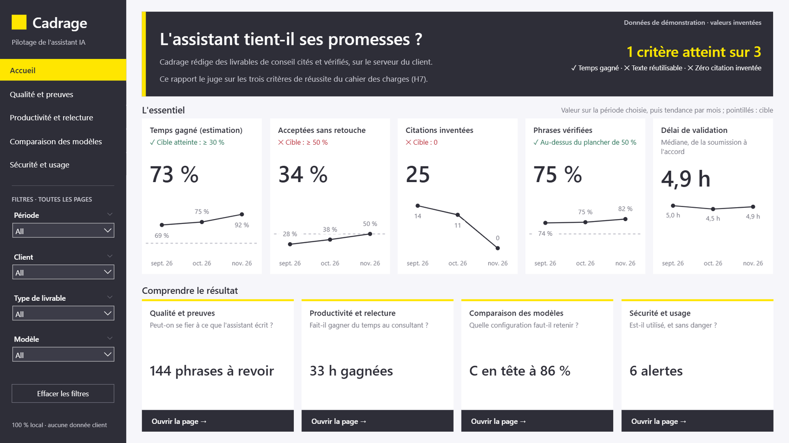

# Tableau de bord Power BI

Le rapport répond à une question : **l'assistant Cadrage tient-il ses promesses ?** Une page d'accueil donne le verdict
sur les trois critères de réussite du cahier des charges (hypothèse H7), puis quatre pages l'expliquent.

> **Valeurs inventées.** Les chiffres du jeu de démonstration (`python -m app.dw.demo --seed 42`) sont fictifs : ils
> montrent le pilotage possible et ne jugent aucun modèle réel. Le rapport l'affiche sur chaque page.



| Page | Question de pilotage | Capture |
|---|---|---|
| Accueil | L'assistant tient-il ses promesses ? | [voir](../docs/img/powerbi-accueil.png) |
| Qualité et preuves | Peut-on se fier à ce que l'assistant écrit ? | [voir](../docs/img/powerbi-qualite.png) |
| Productivité et relecture | Fait-il gagner du temps au consultant ? | [voir](../docs/img/powerbi-productivite.png) |
| Comparaison des modèles | Quelle configuration faut-il retenir ? | [voir](../docs/img/powerbi-modeles.png) |
| Sécurité et usage | Est-il utilisé, et sans danger ? | [voir](../docs/img/powerbi-securite.png) |

Indicateurs (formule, intérêt, cible, limite) : [`KPI.md`](KPI.md). Contenu de chaque page : [`pages.md`](pages.md).

## Confidentialité (contrainte C1)

- Power BI **Desktop** tourne en local. **Ne pas publier** sur Power BI Service, hébergé par Microsoft.
- L'entrepôt `dw` ne contient ni phrases ni passages des clients ([07 §1](../docs/07-entrepot-bi.md)), et le rôle
  `bi_reader` n'a accès qu'à ce schéma.

## Ouvrir le rapport

1. Produire les données :

   ```powershell
   cd backend
   python -m app.dw.demo --seed 42
   python -m app.dw.export_csv --out ../bi/export/
   ```

2. Régler le dossier des CSV (chemin absolu), ce qui régénère le projet :

   ```powershell
   python bi/pbip/build_pbip.py --csv "C:\chemin\vers\bi\export"
   ```

   Sans régénérer : dans Power BI, *Transformer les données → Modifier les paramètres → DossierCsv*.

3. Ouvrir `bi/pbip/CadrageIA.pbip`. Le cache de données n'est pas versionné : cliquer **Refresh now**, puis
   **Apply changes** si le bandeau « pending changes » s'affiche. Ce bandeau apparaît à la première ouverture d'un
   projet sans cache et ne modifie pas les fichiers.

Dans Power BI Desktop, les boutons de navigation se suivent avec **Ctrl + clic**.

### Avec de vraies données

- CSV : `python -m app.dw.etl`, puis le même export.
- PostgreSQL, en lecture seule : `psql -f db/dw/roles.sql` (changer le mot de passe), puis dans les paramètres
  `Source` = `PostgreSQL`, `PgServer`, `PgDatabase`. Importer avec `bi_reader`. **Ce chemin n'a pas été testé dans
  Power BI Desktop** (pilote Npgsql, port 5432 à exposer en local seulement).
- Export anglais (`--locale en`) : paramètre `CultureCsv` = `en-US`. Non testé dans Power BI Desktop.

## Modifier le rapport

Le projet PBIP est **généré**. Ne pas enregistrer depuis Power BI : la génération suivante écraserait la modification.

| Pour changer | Fichier |
|---|---|
| un indicateur, une formule, un seuil | [`pbip/indicateurs.py`](pbip/indicateurs.py) (génère aussi `KPI.md` et `measures.dax`) |
| une table, un libellé, une relation | [`pbip/modele.py`](pbip/modele.py) |
| une page, un visuel, la barre latérale | [`pbip/rapport.py`](pbip/rapport.py), briques dans [`pbip/pbir.py`](pbip/pbir.py) |
| les couleurs et polices | [`theme/cadrage-ey.json`](theme/cadrage-ey.json) |

Ensuite : fermer Power BI, lancer `python bi/pbip/build_pbip.py`, rouvrir et **regarder chaque page**.

Pièges rencontrés :

- **Thème ignoré en silence** : une seule propriété inconnue (ici `tertiaryBackground`) fait rejeter tout le thème,
  et Power BI revient à ses couleurs bleues.
- **`Formula.Firewall`** : une requête ne peut pas référencer une autre requête et lire une source. Chaque table lit
  donc la vue elle-même, par la fonction `Vue`.
- **« A cyclic reference was encountered during evaluation »**, par intermittence à la première actualisation : le
  chargement parallèle est coupé dans `CadrageIA.SemanticModel/.pbi/editorSettings.json`, qui est versionné.

## Modèle de données

Étoile en français au-dessus des vues de [07 §4](../docs/07-entrepot-bi.md). Les colonnes techniques sont masquées.

| Table | Vue source | Filtrée par |
|---|---|---|
| Générations | `v_generation` | période, client, type, modèle |
| Citations | `v_citations` | les mêmes, via Générations |
| Sections approuvées | `v_outcome` | période (date d'approbation), client, type, modèle |
| Relectures | `v_review_funnel` | période (date d'approbation), client, type |
| Documents | `v_security` | période (première génération de la mission), client |
| Appels au modèle | `v_llm_calls` | période, client, modèle |

Dimensions : Calendrier, Missions (client), Types de livrable, Configurations. Les quatre segments de la barre
latérale sont synchronisés sur les cinq pages. La vue `v_quality_by_model` n'est pas importée : c'est un agrégat que
les mesures recalculent en respectant les filtres.

`v_outcome.baseline_minutes` sert de dénominateur au temps gagné. Avec un export antérieur à cette colonne, le
modèle applique la valeur de l'ETL (30 min par section).

## Charte

- Anthracite `#2E2E38`, gris `#747480` et `#C4C4CD`, fond `#F6F6FA`, Segoe UI.
- Jaune `#FFE600` pour ce qu'il faut regarder : page active, total, meilleure valeur.
- Rouge et vert réservés aux statuts, toujours doublés d'un signe ou d'un libellé.
- Ni logo ni nom de cabinet : le produit s'appelle « Cadrage ».

## Sources de conception

1. Microsoft Learn, [Design the analytical report layout](https://learn.microsoft.com/en-us/training/modules/power-bi-effective-reports/2-design-layout) :
   placement, équilibre, contraste, proximité, répétition. D'où la grille unique et la barre latérale répétée.
2. Microsoft Learn, [Design visually appealing reports](https://learn.microsoft.com/en-us/training/modules/power-bi-effective-reports/3-design-reports) :
   espace réservé au titre, à la marque et aux segments, séparé des visuels.
3. Microsoft Learn, [Enhance Power BI report designs for the user experience](https://learn.microsoft.com/en-us/training/modules/power-bi-effective-user-experience) :
   navigation pensée dès le départ et placée au même endroit partout.
4. Microsoft, [PL-300, atelier de conception de rapports](https://microsoftlearning.github.io/PL-300-Microsoft-Power-BI-Data-Analyst/Instructions/Labs/08-design-power-bi-reports.html) :
   segments synchronisés entre les pages.
5. Microsoft Learn, [Power BI Desktop project report folder](https://learn.microsoft.com/en-us/power-bi/developer/projects/projects-report)
   et [semantic model folder](https://learn.microsoft.com/en-us/power-bi/developer/projects/projects-dataset) :
   format PBIR, ressources enregistrées du thème, fichiers `.pbi/` à versionner ou non.
