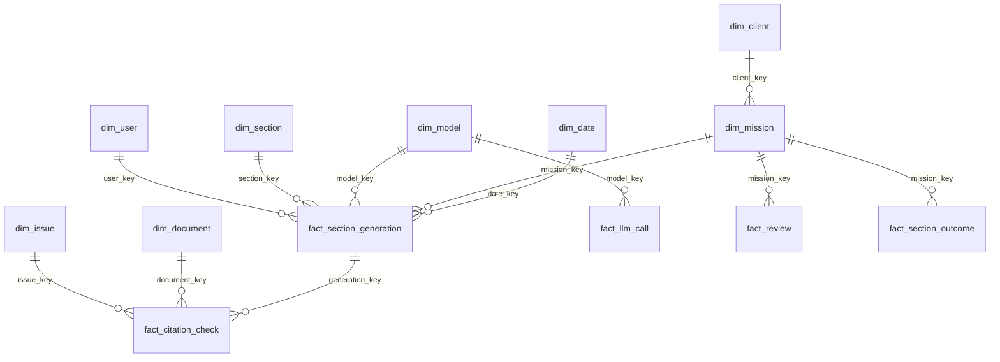

# 07 — Entrepôt de données et tableau de bord

> Lots E1 (schéma, chargement, vues, indicateurs) et E2 (démo, export CSV, Power BI, Metabase). Testé cette nuit sur **SQLite** ; Postgres et Power BI Desktop **demain avec l'utilisateur**.

## 1. Principes

- Schéma `dw` dans la même base PostgreSQL que l'application (en SQLite : mêmes tables grâce à `schema_translate_map={"dw": None}`, préfixe implicite). Défini en **SQLAlchemy Core** (`app/dw/schema.py`), migration Alembic `0002_dw.py` (Postgres, demain).
- Alimenté **uniquement** par l'ETL à partir des tables opérationnelles (`06` §4.2) ; aucune écriture de l'application dans `dw`.
- **Aucun texte client** dans l'entrepôt : pas de phrases, pas de passages ; seulement identifiants, compteurs, mesures, noms de dossiers/clients (pseudonymisables : `settings.dw_pseudonymize=True` remplace par `Client 001`).
- Toute ligne porte `is_demo BOOLEAN` : les données de démonstration ne se mélangent jamais aux vraies (filtre par défaut dans les vues : `is_demo = settings`).

## 2. Modèle en étoile



### 2.1 Dimensions

| Table | Colonnes (type) | Remarques |
|---|---|---|
| `dim_date` | `date_key INT PK` (aaaammjj), `date DATE`, `year SMALLINT`, `quarter SMALLINT`, `month SMALLINT`, `month_name_fr VARCHAR(12)`, `iso_week SMALLINT`, `day_of_week SMALLINT`, `is_weekend BOOL` | générée 2025-01-01 → 2028-12-31 |
| `dim_client` | `client_key INT PK`, `client_name VARCHAR(200)`, `sector VARCHAR(80) NULL`, `is_demo BOOL` | clé naturelle : `client_name` |
| `dim_mission` | `mission_key INT PK`, `dossier_id VARCHAR(32) UNIQUE`, `client_key INT FK`, `mission_name VARCHAR(200)`, `language CHAR(2)`, `created_date_key INT`, `is_demo BOOL` | 1 dossier = 1 mission |
| `dim_document` | `document_key INT PK`, `document_id VARCHAR(32) UNIQUE`, `mission_key INT FK`, `mime VARCHAR(80)`, `pages INT NULL`, `chunk_count INT`, `injection_alert_count INT`, `is_demo BOOL` | pas de nom de fichier |
| `dim_user` | `user_key INT PK`, `user_id VARCHAR(32) UNIQUE`, `role VARCHAR(20)`, `user_label VARCHAR(80)`, `is_demo BOOL` | `user_label` = nom affiché ou pseudonyme |
| `dim_model` | `model_key INT PK`, `provider VARCHAR(40)`, `model_name VARCHAR(120)`, `adapter VARCHAR(120) NULL`, `quantization VARCHAR(20) NULL`, `config_label CHAR(1) NULL` (A/B/C/D), `is_demo BOOL` | unique (provider, model_name, adapter, config_label) |
| `dim_deliverable_type` | `type_key SMALLINT PK`, `type_code VARCHAR(12)` (findings, roadmap, tor, cdc), `label_fr VARCHAR(60)`, `label_en VARCHAR(60)` | statique |
| `dim_section` | `section_key INT PK`, `type_key FK`, `template_id VARCHAR(60)`, `section_code VARCHAR(60)`, `title_fr VARCHAR(200)`, `baseline_minutes NUMERIC(6,1)` | `baseline_minutes` = temps manuel estimé (hypothèse paramétrable, voir §5) |
| `dim_issue` | `issue_key SMALLINT PK`, `issue_code VARCHAR(30)`, `severity VARCHAR(10)`, `label_fr VARCHAR(120)` | codes de `06` §3 + `NONE` |
| `dim_state` | `state_key SMALLINT PK`, `state_code VARCHAR(12)`, `label_fr VARCHAR(30)`, `step_order SMALLINT` | draft 1, in_review 2, approved 3, rejected 3 |

Dimensions de type 1 (écrasement). Les versions de modèle sont des lignes distinctes de `dim_model` (une nouvelle version = nouvelle clé), ce qui suffit à comparer.

### 2.2 Faits (grain exact)

**`fact_section_generation`** — grain : **une tentative de génération d'une section** (un `generation_runs` de type `section` ou `findings`).
| Colonne | Type | Source |
|---|---|---|
| `generation_key` | BIGINT PK | séquence |
| `run_id` | VARCHAR(32) UNIQUE | clé naturelle |
| `date_key`, `mission_key`, `model_key`, `section_key`, `user_key` | INT FK | |
| `status` | VARCHAR(12) | ok / refused / invalid / error |
| `sentences_total`, `sentences_verified`, `sentences_warning`, `sentences_failed` | INT | verification_results |
| `citations_total`, `citations_valid` | INT | |
| `numbers_cited`, `numbers_found` | INT | |
| `passages_retrieved` | INT | retrieval_hits |
| `attempts` | SMALLINT | |
| `latency_ms`, `tokens_in`, `tokens_out` | INT | |
| `is_demo` | BOOL | |

**`fact_citation_check`** — grain : **une paire (phrase, source citée)** d'une génération.
`citation_key BIGINT PK`, `generation_key FK`, `document_key FK NULL` (NULL si source inconnue), `issue_key FK`, `sentence_index SMALLINT`, `is_valid BOOL`, `support NUMERIC(4,3)`, `is_demo`.

**`fact_llm_call`** — grain : **un appel au modèle** (y compris les nouvelles tentatives et les embeddings par lot).
`call_key BIGINT PK`, `date_key`, `model_key`, `mission_key`, `call_kind VARCHAR(12)` (section, findings, initiatives, embed), `latency_ms INT`, `tokens_in INT`, `tokens_out INT`, `success BOOL`, `is_demo`.
(Cette nuit, un run = un appel sauf nouvelles tentatives ; l'ETL dérive `fact_llm_call` de `generation_runs.attempts`, latence répartie à parts égales — **approximation notée**.)

**`fact_review`** — grain : **une transition d'état d'un livrable**.
`review_key BIGINT PK`, `transition_id VARCHAR(32) UNIQUE`, `date_key`, `mission_key`, `type_key`, `user_key`, `from_state_key`, `to_state_key`, `version INT`, `hours_since_previous NUMERIC(10,2)`, `has_reason BOOL`, `is_demo`.

**`fact_section_outcome`** — grain : **une section d'une version approuvée** (mesure le travail humain).
`outcome_key BIGINT PK`, `deliverable_id VARCHAR(32)`, `approved_version INT`, `date_key`, `mission_key`, `section_key`, `model_key` (dernière génération de la section), `generated_words INT`, `final_words INT`, `edit_ratio NUMERIC(5,4)`, `unchanged BOOL`, `was_refused BOOL`, `minutes_saved_est NUMERIC(7,1)`, `is_demo`.
`edit_ratio = 1 − difflib.SequenceMatcher(None, mots_générés, mots_finaux).ratio()` ; `unchanged = edit_ratio = 0`.

### 2.3 Tables techniques
`etl_watermark (source_table VARCHAR PK, last_value VARCHAR, updated_at)` ; `etl_log (id, started_at, ended_at, rows_by_table JSON, status, error)`.

## 3. Chargement (ETL) — `app/dw/etl.py`

```python
def run_etl(op_engine: Engine, dw_engine: Engine, *, full: bool = False,
            now: datetime | None = None) -> dict[str, int]: ...   # lignes insérées par table
```
1. Ordre : dimensions statiques (`dim_date`, `dim_deliverable_type`, `dim_issue`, `dim_state`, `dim_section` depuis les gabarits YAML) → dimensions de référence (client, mission, document, user, model) → faits.
2. **Incrémental** par filigrane : `generation_runs.started_at`, `state_transitions.at`, `deliverable_versions.created_at`. Fenêtre de sécurité de 5 min ; unicité par clé naturelle (`run_id`, `transition_id`, `(deliverable_id, approved_version, section_code)`) → **idempotent** (relancer ne duplique rien).
3. Upsert : `INSERT … ON CONFLICT DO NOTHING/UPDATE` (dialectes `sqlite` et `postgresql` de SQLAlchemy).
4. `fact_section_outcome` : pour chaque transition `→ approved`, comparer la section de la version approuvée à la **dernière version `generated`** de cette section.
5. Commande : `python -m app.dw.etl [--full]` ; journal dans `etl_log`. Planification : cron/tâche planifiée du serveur (doc G1).

## 4. Vues pour Power BI (`app/dw/views_sql.py`, SQL portable SQLite/Postgres)

| Vue | Contenu |
|---|---|
| `v_generation` | fait génération + libellés (client, mission, modèle, config, type, section, mois) + `tpv` par ligne |
| `v_quality_by_model` | par `model_key`, `config_label` : n générations, TPV, citations valides, fidélité des chiffres, taux de refus, latence moyenne |
| `v_review_funnel` | par livrable : date soumission, date approbation, nombre de refus, délai en heures |
| `v_outcome` | sections approuvées : edit_ratio, unchanged, minutes économisées |
| `v_citations` | contrôles de citations par code d'anomalie et document |
| `v_security` | alertes d'injection par mission et document |
| `v_llm_calls` | appels : latence, jetons/s (`tokens_out * 1000.0 / NULLIF(latency_ms,0)`) |

Pas de fonctions propres à Postgres dans les vues (pas de `percentile_cont`) : les percentiles se calculent en **DAX** ou dans `kpi.py`.

## 5. Indicateurs (formules exactes)

| Indicateur | Formule | Implémentation |
|---|---|---|
| **TPV — taux de phrases vérifiées** | Σ sentences_verified / Σ sentences_total (générations `ok`) | `kpi.tpv`, DAX `[TPV]` |
| Citations valides | Σ citations_valid / Σ citations_total | |
| Fidélité des chiffres | Σ numbers_found / Σ numbers_cited (1 si aucun chiffre) | |
| Taux de refus | nb status=refused / nb générations | |
| Taux d'invalides | nb status=invalid / nb générations (JSON non conforme après essais) | |
| Acceptation sans modification | nb outcome.unchanged / nb outcome | |
| Distance d'édition moyenne | AVG(edit_ratio) | |
| Temps gagné estimé (min) | Σ baseline_minutes × (1 − edit_ratio) − 0 (temps de relecture non mesuré) | **hypothèse** : `baseline_minutes` par section à faire valider par EY ; affiché « estimation » |
| Délai de validation (h) | médiane(heures entre 1ʳᵉ soumission et approbation) | |
| Taux de refus en relecture | nb transitions →rejected / nb soumissions | |
| Latence p50 / p95 | percentiles de `fact_llm_call.latency_ms` | DAX `PERCENTILEX.INC`, `kpi.percentile` |
| Débit | Σ tokens_out / Σ latency_s | |
| Alertes d'injection | Σ dim_document.injection_alert_count | |

`kpi.py` : fonctions pures `(rows) -> float` testées contre des jeux de lignes calculés à la main ; les mêmes chiffres doivent sortir des vues SQL (test de cohérence vue ↔ Python).

## 6. Mesures DAX (fichier `bi/measures.dax`)

```DAX
TPV = DIVIDE(SUM(v_generation[sentences_verified]), SUM(v_generation[sentences_total]))
Citations valides = DIVIDE(SUM(v_generation[citations_valid]), SUM(v_generation[citations_total]))
Fidélité chiffres = IF(SUM(v_generation[numbers_cited]) = 0, 1,
    DIVIDE(SUM(v_generation[numbers_found]), SUM(v_generation[numbers_cited])))
Taux refus = DIVIDE(CALCULATE(COUNTROWS(v_generation), v_generation[status] = "refused"), COUNTROWS(v_generation))
Acceptation sans modif = DIVIDE(CALCULATE(COUNTROWS(v_outcome), v_outcome[unchanged] = TRUE()), COUNTROWS(v_outcome))
Temps gagné (h) = SUM(v_outcome[minutes_saved_est]) / 60
Latence p95 (s) = PERCENTILEX.INC(v_llm_calls, v_llm_calls[latency_ms], 0.95) / 1000
Δ TPV vs B = [TPV] - CALCULATE([TPV], v_generation[config_label] = "B")
```

## 7. Maquette du tableau de bord (Power BI Desktop, 5 pages)

| Page | Visuels |
|---|---|
| 1. Vue d'ensemble | cartes : TPV, Acceptation sans modif, Temps gagné (h), Livrables approuvés ; courbe TPV par semaine ; segment client / type |
| 2. Qualité et vérification | barres empilées des anomalies par code ; matrice section × TPV (mise en forme conditionnelle) ; fidélité des chiffres par type |
| 3. Comparaison des modèles (A/B/C/D) | histogramme groupé TPV, citations, refus par config ; nuage latence p95 × TPV (taille = n) ; table avec Δ vs B |
| 4. Relecture | entonnoir draft → in_review → approved ; délai médian ; taux de refus en relecture ; top sections les plus réécrites (edit_ratio) |
| 5. Usage et sécurité | générations par mission et mois ; alertes d'injection par mission ; documents par format |

Charte : couleurs neutres, une couleur d'accent ; libellés en français ; filtre « Données de démonstration » visible en haut de chaque page.

## 8. Connexion Power BI **sans fuite**

- **Power BI Desktop** (local) → connecteur PostgreSQL vers `localhost:5432`, rôle **lecture seule** `bi_reader` limité au schéma `dw` (script `db/dw/roles.sql`). Le pilote nécessaire (Npgsql) est **à vérifier** selon la version de Power BI Desktop.
- **Plan B sans base** : `python -m app.dw.export_csv --out bi/export/` écrit une CSV UTF-8 (séparateur `;`, décimale `,` pour Excel FR — option `--locale en`) par vue ; Power BI → « Texte/CSV ». Testable cette nuit.
- Ne **pas** publier sur Power BI Service (cloud Microsoft) : contraire à C1. Power BI Report Server sur site : licence **à vérifier**.

## 9. Générateur de données de démonstration — `app/dw/demo.py`

```python
def generate_demo(op_engine: Engine, *, seed: int = 42, clients: int = 5, missions: int = 12,
                  days: int = 90, start: date = date(2026, 9, 1)) -> dict[str, int]: ...
```
- Écrit dans les tables **opérationnelles** (utilisateurs, dossiers, documents, runs, vérifications, transitions, versions) avec la colonne `dossiers.is_demo = TRUE` (définie par B1) ; l'ETL propage `is_demo` à toutes les lignes qui en dérivent ; dossiers nommés « [DÉMO] … ». Puis on lance l'ETL : la démo teste **aussi** la chaîne de chargement.
- Distributions (graine fixe) : config A TPV ≈ 0,35, B ≈ 0,82, C ≈ 0,86, D ≈ 0,78 ; latence lognormale (B : médiane 9 s) ; 8 % de refus en B ; edit_ratio bêta(2,5) ; 15 % de livrables refusés une fois en relecture. Ce sont des **valeurs inventées** pour la démonstration, signalées comme telles dans le tableau de bord et le rapport.
- Commande : `python -m app.dw.demo --seed 42` ; test : deux exécutions avec la même graine → mêmes indicateurs.

## 10. Alternative libre : Metabase

- Service optionnel `metabase` dans `deploy/docker-compose.bi.yml` (profil `bi`), réseau `internal`, connecté avec `bi_reader`. Image **à télécharger demain** ; licence AGPL (usage interne non modifié — **à vérifier**).
- Livrable : une page `bi/metabase.md` (connexion, 5 questions SQL reprenant les vues). Pas de tableau construit cette nuit.

## 11. Tests (lot E1/E2)

1. ETL sur SQLite avec un jeu opérationnel construit à la main (2 dossiers, 5 runs, 3 transitions) → comptes attendus par table.
2. Idempotence : `run_etl` deux fois → aucune ligne en plus.
3. Incrémental : ajout d'un run après la 1ʳᵉ exécution → 1 seule ligne nouvelle.
4. Cohérence vues ↔ `kpi.py` (TPV, acceptation, temps gagné) à 1e-9 près.
5. Pseudonymisation : aucun nom de client réel dans `dim_client` si activée.
6. Aucune colonne de texte libre client dans `dw` (test d'introspection : liste blanche des colonnes `VARCHAR` > 200).
7. Démo : déterminisme par graine ; `is_demo` vrai partout.
