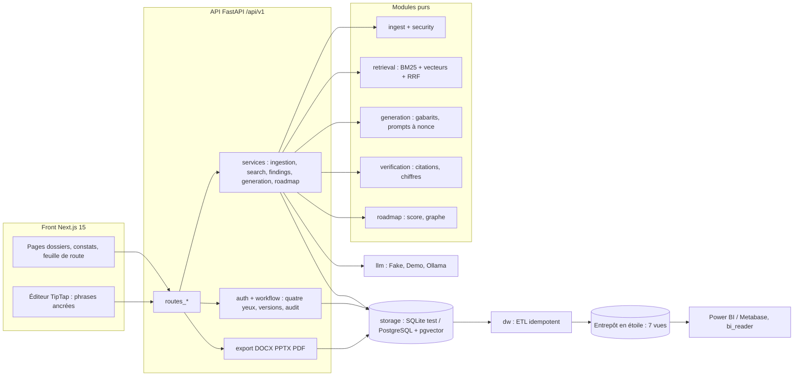

# 12 — Journal d'orchestration (lecteur technique)

Source : journal de l'orchestrateur (mémoire `rapport.md`), `docs/STATUS.md`, `docs/lots/*.md`. Fuseau UTC+1. **Les horodatages sont ceux du journal, approximatifs** : il signale lui-même un décalage (« ~22 h 30 / 22 h 35 » = en réalité ~22 h 15 / 22 h 17 pour les premières vagues). Ce qui n'est pas dans le journal est écrit « non mesuré ».

## 1. Cadre et autorisations
- Projet : assistant IA 100 % local (FastAPI Python 3.12 + Next.js), dépôt `YoussefBY22/PRV-PR8-PFE-IA-Cadrage`. Forfait **Pro**. Orchestrateur : Opus 5.5, effort moyen, mode auto, session `local_5eb73151-8f92-4e87-89e5-af678f6de606`.
- PC : Python 3.12.3, Node 24.11.1, npm 11.6.2, Docker 29.2.1 (démon arrêté), 36 Go libres.
- Autorisé (21/11, 22 h) : jusqu'à 100 % de l'hebdomadaire ; réseau = pip, npm, git fetch/push ; **interdits** : modèles, Ollama, images Docker, navigateur, téléchargement de corpus ; pas de Docker ; sessions locales (worktrees), aucune en cloud.

## 2. Chronologie
| Heure (21→22/11) | Événement |
|---|---|
| ~21 h 50 | Phase A (session cloud Sonnet, tâche `task_72b0db0b`) : socle FastAPI, `LLMProvider`/`FakeProvider`/`OllamaProvider`, journal sans contenu, garde-fou réseau, compose. 22 tests, 29 fichiers, +1 023 lignes, commit 4650fed |
| 22 h 05 | Mise en place : questions à l'utilisateur, branche `phase-a`, cron de contrôle à 00 h 27, **une seule** session Opus d'architecture |
| ~22 h 30 | Architecte terminé (7798a26) : docs 05 à 09 (+1 234 lignes), plan de 18 lots en 6 vagues ; branche `integration` créée |
| ~22 h 35 | V0 : B0 (socle, contrats) → fusionné 53f5a29 ; 46 tests |
| ~22 h 30 | V1 (B1 à B4) fusionnée e43ccd6 ; **152 passed, 1 skipped** |
| ~22 h 36 | V2 (B5, C1 à C3) fusionnée e26062c ; **256 passed, 1 skipped** |
| ~22 h 46 | V3 (C4, D1, D2, E1) fusionnée c3389e3 ; **339 passed, 2 skipped** |
| ~22 h 47 | Décision de rythme : 5 h à 89 % → on ne lance que F1 |
| ~22 h 54 | F1 fusionné 5b13d45 ; **350 passed** ; 5 h à 93 % → pause volontaire jusqu'au reset |
| 00 h 28 | Reset ; V4 par réutilisation de sessions (D3a, E2, F2) |
| ~00 h 38 | V4 fusionnée 663272a ; backend 361 passed, training 22, front 12 |
| ~00 h 40 → 00 h 46 | V5 (D3b, G1) ; fusionnée 11f1182 ; **388 passed, 2 skipped** ; front 22 ; **19 lots faits** |
| ~00 h 47 → 00 h 54 | Passe finale R1 (revue réelle) et R2 (documentation) en parallèle ; fusionnés db31e43 ; **397 passed, 2 skipped**, front 22 |
| ~00 h 54 | Rédaction du rapport (R3) |

Durée totale orchestrée (22 h 05 → 00 h 54) : environ **2 h 50**, à ± 15 min près.

## 3. Sessions
| Nom | Id (début) | Modèle | Lots réalisés | Branche(s) |
|---|---|---|---|---|
| orchestrateur | `local_5eb73151…` | Opus 5.5 | pilotage, fusions, contrôles | `integration` |
| architecte | `local_600c9e44…` | Opus 5.5 | docs 05 à 09 | `claude/architecture-67c452` |
| dev-b0 | `local_72102192…` | Sonnet 5.5 | B0 ; puis D1, G1 | `claude/lot-b0-2d5684`, `lot-d1`, `lot-g1` |
| dev-b1 | `local_2a232f23…` | Sonnet 5.5 | B1 ; puis E1, E2 | `claude/lot-b1-697d60`, `lot-e1`, `lot-e2` |
| dev-b2 | `local_9448d8de…` | Sonnet 5.5 | B2 | `claude/lot-b2-10b2b2` |
| dev-b3 | `local_83ac194f…` | Sonnet 5.5 | B3 | `claude/lot-b3-49b011` |
| dev-b4 | `local_2a6f3015…` | Sonnet 5.5 | B4 ; puis F2 | `claude/lot-b4-94409a`, `lot-f2` |
| dev-b5 | `local_7548b739…` | Sonnet 5.5 | B5 ; puis D3a, D3b | `claude/lot-b5-5ca200`, `lot-d3a`, `lot-d3b` |
| dev-c1 | `local_8311f307…` | Sonnet 5.5 | C1 ; puis D2 | `claude/lot-c1-7fb595`, `lot-d2` |
| dev-c2 | `local_3cdd4dac…` | Sonnet 5.5 | C2 ; puis R1 | `claude/lot-c2-60e717`, `lot-r1` |
| dev-c3 | `local_22a8c287…` | Sonnet 5.5 | C3 ; puis R2, R3 | `claude/lot-c3-8ebf91`, `lot-r2`, `lot-r3` |
| dev-c4 | `local_3b688ff4…` | Sonnet 5.5 | C4 ; puis F1 | `claude/lot-c4-25df1f`, `lot-f1` |
| phase A | `task_72b0db0b` | Sonnet (défaut cloud) | phase A | `claude/exciting-volta-qipfkc` |
Effort des Sonnet : moyen (journal). Les branches `claude/lot-*` ont des noms imposés par l'application (le plan prévoyait `lot/<ID>`).

## 4. Ordres donnés
- **Architecte** : produire `05-revue-perimetre`, `06-architecture`, `07-entrepot-bi`, `08-modele-rag-evaluation`, `09-plan-execution` (lots, fichiers possédés, parallélisme, briefs prêts à coller), compléter le glossaire, pousser. Contraintes : pas de web, stockage abstrait testable sans Docker, corpus synthétique.
- **Ordre type d'un développeur** : « réalise le lot X de `09` ; lis §1, §4 et ton brief et seulement les sections citées de 06/07/08 ; crée un venv `backend/.venv`, `pip install -e .` puis `pytest ruff reportlab` explicitement (groupe `[dependency-groups]`) ; réseau seulement pour pip ; ne modifie que tes fichiers ; `ruff check .` et `pytest -q` verts ; compte rendu `docs/lots/X.md` ; commit avec l'identité du §1, sans mention d'assistant ; `git push -u origin HEAD` ; réponse de 8 lignes au plus ».
- **Réutilisation** : message à une session inactive avec `git switch -c lot-xx integration`, puis le même ordre type.
- Précisions par lot : C2 (taux de détection demandé) ; D3a (npm autorisé, télémétrie Next coupée, vitest au lieu de Playwright) ; E2 (fichiers Power BI et docs, connexion testée demain) ; F2 (mode simulation, imports paresseux, pas de torch/transformers/peft lourds) ; G1 (sans Docker, corriger la sortie réseau de l'API signalée en phase A) ; R1 (revue réelle uvicorn + SQLite, corrections avec tests de non-régression, script de démo) ; R2 (STATUS, glossaire, README, index des lots) ; R3 (ce rapport, 5 lignes de réponse).

## 5. Méthode
1. **Plan par vagues** : 19 lots, ≤ 4 en parallèle ; chemin critique B0 → B1 → B5 → C4 → F1. Priorités P1 (B, C, D1, D2), P2 (E, F1, D3), P3 (F2, G1).
2. **Matrice de propriété** (`09` §4) : chaque lot ne touche que ses fichiers ; un conflit hors périmètre serait une violation. Résultat : **toutes les fusions sans conflit**. Les besoins hors périmètre sont écrits en « Demandes » dans le compte rendu.
3. **Réutilisation des sessions** : l'application refuse plus de 10 sessions lancées par message utilisateur. Contournement : réutiliser des sessions inactives par `SendMessage`, en choisissant celle dont le lot précédent est le plus proche (D1 → dev-b0 qui a écrit `deps.py`, D2 → dev-c1 auteur des gabarits, E1 → dev-b1 auteur du stockage, D3a/D3b → dev-b5, etc.). Contrepartie : un contexte déjà chargé coûte plus (voir §6).
4. **Pause volontaire à 93 %** de la fenêtre de 5 h (22 h 54) jusqu'au reset (cron à 00 h 27) : aucune session n'a été coupée en plein travail.
5. **Contrôle après chaque vague** (`09` §6) : fusion dans l'ordre, puis par l'orchestrateur sur Windows `ruff check .` et `pytest -q` (et front `npm ci`, eslint, vitest), nombre de tests noté, push d'`integration`.
6. **Économies de jetons** : une seule session Opus ; briefs lus par les développeurs dans `09` plutôt que recopiés ; réponses de 8 lignes ; lecture ciblée (titres, `tail`) ; documents de synthèse confiés à des sessions Sonnet.
7. **Incident noté** : `pip install -e .[dev]` n'installe pas les outils (groupe `[dependency-groups]`) → consigne explicite ajoutée aux briefs dès B0.

## 6. Consommation (forfait Pro ; points de pourcentage ; orchestrateur inclus dans chaque ligne)
| Tâche | Fenêtre 5 h | Hebdo |
|---|---|---|
| Rédaction initiale + phase A cloud (avant 21 h 58) | 34 | jusqu'à 64 (inclut le reste de la semaine) |
| Architecte Opus + mise en place | 12 | 2 |
| B0 | 3 | < 1 |
| V1 (B1 à B4) | 13 | 2 |
| V2 (B5, C1 à C3) | 10 | 2 |
| V3 (C4, D1, D2, E1) | 17 | 3 |
| F1 | 4 | 1 |
| V4 (D3a, E2, F2) | 13 | 2 |
| V5 (D3b, G1) | 7 | 2 |
| R1 + R2 | 9 | 1 |
| **Total de la nuit** | **88** (59 fenêtre 1 + 29 fenêtre 2) | **15** (64 → 79) |
| R3 (ce rapport) | non mesuré | non mesuré |

Relevés : 21/11 21 h 58 : 34 % / 64 % · 22 h 17 : 46 / 66 (après architecte) · 22 h 23 : 49 / 66 · 22 h 30 : 62 / 68 · 22 h 36 : 72 / 70 · 22 h 46 : 89 / 73 · 22 h 54 : 93 / 74 · 22/11 00 h 28 : 3 / 74 (reset 5 h à 05 h 20) · 00 h 39 : 16 / 76 · 00 h 46 : 23 / 78 · 00 h 54 : 32 / 79 (reset hebdomadaire le 25/11 à 16 h). Contexte de l'orchestrateur : 103 k jetons à 21 h 58, 132 k à 22 h 17, 141 k à 22 h 23.
Lecture : un lot Sonnet ≈ 3 à 4 pts de 5 h ; l'architecte Opus ≈ 10 pts seul ; V3 est la vague la plus chère (sessions réutilisées, lots les plus lourds), puis l'architecte, V1 et V4. Jetons consommés : non mesurés.

## 7. Arborescence finale (`git ls-files`, branche `lot-r3`)
312 fichiers. Par dossier :
| Dossier | Fichiers | Contenu |
|---|---|---|
| `backend/app/` | 100 | api, domain, storage, ingest, security, retrieval, generation, verification, roadmap, workflow, auth, export, dw, services, llm |
| `backend/tests/` | 64 | un sous-dossier par module |
| `frontend/` | 45 | Next.js 15 : pages, `lib/`, `components/editor/` |
| `docs/` | 33 | documents 01 à 12, STATUS, `lots/` |
| `training/` | 17 | jeu d'entraînement, LoRA, simulation |
| `backend/eval/` | 17 | corpus or, banc d'évaluation, configs |
| `deploy/` | 11 | nginx, sauvegarde, paquet hors ligne, compose BI |
| `bi/` · `backend/migrations/` · `backend/scripts/` | 5 · 4 · 3 | Power BI/Metabase ; Alembic 0001, 0002 ; création de compte, démo |
| `db/` · `data/` · `.github/` · racine · `backend/` (racine) | 2 · 2 · 1 · 4 · 4 | init SQL ; licences et synthétiques ; CI ; compose, README… ; `pyproject`, Dockerfile… |

Lignes par type (fichiers suivis) : Python 182 fichiers / 13 691 lignes · TypeScript 15 / 884 · TSX 19 / 1 453 · Markdown 41 / 2 943 · YAML 14 / 453 (`.yaml` + `.yml`) · JSON 3 / 8 091 (surtout `package-lock.json` et `gold.json`) · shell 8 / 158 (`.sh` + `.ps1`) · SQL 2 / 25 · CSS 2 / 31. 38 commits sur la branche à la date de ce rapport.

## 8. Architecture

Règle de couches (`06` §1) : api → services → modules purs → storage + llm ; un module pur n'importe ni `storage` ni `api`. Écarts connus : plusieurs services lisent via `repo.engine` (STATUS §3).

## 9. Modèles retenus (`08`) : ce qui devrait marcher / à vérifier
Rien n'a été vérifié en ligne ; **toutes** les tailles, licences et disponibilités sont « à vérifier » (T2).
| Rôle | Choix | Ce qui devrait marcher | À vérifier |
|---|---|---|---|
| Génération B (référence) | Qwen3-4B Q4_K_M (~2,5 Go) | tient en 4 Go avec contexte 4 k, JSON contraint via Ollama | licence Apache-2.0, qualité en français, modes « réflexion » à désactiver |
| Génération C (LoRA) | Qwen3-1.7B (~1,1 Go) comparé à B-1.7B | QLoRA ≤ 2 B, séquences ≤ 1 536, fp16 sans bf16 | durée réelle d'entraînement, gain C − B (règle de `08` §6) |
| D | l'autre taille ou Ministral 3 (3 B) | candidat français | licence (Apache-2.0 « annoncé ? ») |
| Embeddings PC | multilingual-e5-small (CPU) | préfixes `query:` / `passage:` gérés par réglage | licence MIT ; préfixe `query:` non encore ajouté aux requêtes (B3/B5) |
| Embeddings serveur | BGE-M3 (1 024 dim.) | dimension configurable ; changer de modèle = ré-indexer | disponibilité dans Ollama |
| Serveur client | 14–30 B (Qwen3-14B, Mistral Small, Qwen3-30B-A3B) | hypothèse 1 GPU 24–48 Go | matériel réel d'EY (question ouverte du CdC) |
Écartés par défaut : Llama 3.2 et Gemma 3 (licences maison).

## 10. Bugs trouvés par R1 (`tests/api/test_r1_regressions.py`)
1. **CORS absent** : le front (:3000) ne pouvait pas appeler l'API (:8000), préflight 405 → réglage `CORS_ORIGINS`, en-têtes d'export exposés.
2. **Format d'erreur** de `06` §6 non respecté pour 401, 422, 404 et 405 (`{"detail": …}`) → gestionnaires globaux `{"error": {"code", "message"}}`.
3. **Aucun modèle utilisable sans GPU** : le `FakeProvider` échoue au vérificateur → `LLM_PROVIDER=demo` (`app/llm/demo.py`) qui cite de vraies phrases.
4. **Pas de création de compte** → `scripts/create_user.py` (mot de passe ≥ 12 car. via `CADRAGE_PASSWORD`).
5. **Console Windows cp1252** : plantage à l'affichage → `errors="replace"` (les accents s'affichent encore mal).
~50 cas d'erreur sondés ; 31 appels du front concordent avec les routes ; migrations 0001/0002 alignées sur le schéma. Limites R1 : constats du modèle demo parfois proches de titres ; un livrable vide peut passer en relecture ; `docker-compose.yml` garde `LLM_PROVIDER=fake` par défaut.

## 11. Limites et suite
- **Jamais exécutés** : Docker, PostgreSQL/pgvector, export PDF (LibreOffice), Ollama, `TorchBackend` et conversion GGUF, Power BI/Metabase, vrai navigateur (Playwright).
- Chiffres (rappel@10 = 1,000 ; 23/23 ; TPV simulé 0,847 IC95 [0,815 ; 0,877]) : corpus synthétique à gabarits et faux modèle, donc sans valeur scientifique. Le TPV prouve l'ancrage, pas la vérité.
- Demandes non intégrées : méthodes `Repository` manquantes, `dw_pseudonymize`, `package-data`, `.gitattributes` (`*.sh text eol=lf`), endpoint `GET /templates/{type}`, `alerts` par document (STATUS §3).
- **Suite** : T1 (PostgreSQL) → T2 (Ollama, licences, éval B) → T3 et T6 (navigateur, LibreOffice, Power BI, Docker) → T4 (corpus public) → T5 (LoRA, éval C vs B). Commandes : `docs/STATUS.md` §5.
