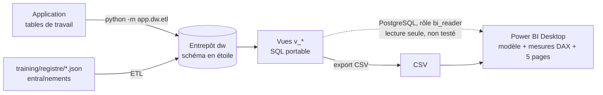

# 22 — Business intelligence : du clic dans l'application au tableau de bord

> Lecteur : toi, un recruteur, un analyste BI. Ce document explique **tout le travail BI** de Cadrage, simplement,
> puis renvoie aux références techniques : [`07-entrepot-bi.md`](07-entrepot-bi.md) (tables et colonnes exactes),
> [`../bi/KPI.md`](../bi/KPI.md) (122 mesures et formules), [`../bi/pages.md`](../bi/pages.md) (contenu des pages),
> [`14-acteurs-dashboard.md`](14-acteurs-dashboard.md) (qui voit quoi).

## 1. À quoi sert le tableau de bord, et pour qui

L'application sert à **produire** (constats, feuille de route, TdR, cahier des charges). Le tableau de bord sert à
**piloter** : comparer les projets entre eux et dans le temps, voir où l'IA se trompe, savoir **quoi faire ensuite**.

| Qui | Ce qu'il y cherche |
|---|---|
| **Consultant** | ses projets, les rapports d'audit dont les recommandations sont à contrôler, les sections à reprendre |
| **Responsable** (valide les livrables) | la file de relecture, les renvois, la qualité avant approbation |
| **Direction du cabinet** | l'activité, la charge, un rapport imprimable d'une page |
| **Profil technique / jury** | la qualité du modèle, les entraînements, la décision d'adopter ou non un modèle |

**Pourquoi Power BI plutôt que des statistiques dans l'application ?** L'application montre un dossier à la fois ;
Power BI croise **tous** les projets, **sur toute la période**, avec des filtres qui se combinent (projet × client ×
consultant × date au jour), des info-bulles, une page imprimable pour une réunion, et des **règles d'action** qui
lisent ces croisements. Ce sont des questions de pilotage, pas de production.

## 2. Le chemin des données, de bout en bout



1. **L'application écrit** dans ses tables de travail : dossiers, fiches projet, documents, recommandations des
   rapports, constats, générations du modèle, vérifications de phrases, versions et états des livrables.
2. **L'ETL** (`python -m app.dw.etl`) lit ces tables et remplit l'**entrepôt** (`dw`). Il est **incrémental** (il ne
   relit que ce qui est nouveau, grâce à des filigranes de date) et **idempotent** (le relancer ne duplique rien).
3. **Des vues** (`v_generation`, `v_project`, `v_report_check`…) préparent les données pour Power BI, en SQL qui
   marche sur SQLite comme sur PostgreSQL.
4. **Power BI** les lit, soit par **export CSV** (`python -m app.dw.export_csv`, chemin testé), soit en direct sur
   PostgreSQL avec un rôle en lecture seule (préparé, **non testé**).
5. **Le modèle Power BI** relie les tables, calcule 122 mesures DAX et affiche 5 pages.

## 3. L'entrepôt, expliqué simplement

**Schéma en étoile** : au centre, des **faits** (ce qui s'est passé, avec des chiffres) ; autour, des **dimensions**
(les axes d'analyse : quand, quel projet, quel modèle, qui). On filtre par les dimensions, on additionne les faits.
Le **grain** d'une table de faits, c'est « une ligne = quoi exactement ».

| Dimension | Une ligne = | Sert à filtrer par |
|---|---|---|
| `dim_date` | un jour (2025 → 2028) | jour, semaine, mois, trimestre |
| `dim_client`, `dim_mission`, `dim_project` | un client, un dossier, sa fiche (demande résumée, dates, logo) | client, projet |
| `dim_document` | un document déposé (sans nom de fichier) | rapport, document |
| `dim_user` | une personne (nom affiché ou pseudonyme) | consultant, responsable |
| `dim_model` | une version de modèle (base, LoRA v4…) | modèle |
| `dim_deliverable_type`, `dim_section` | un type de livrable, une section de gabarit (libellé lisible) | TdR, CdC, feuille de route, section |
| `dim_issue`, `dim_state` | un type d'anomalie, un état de livrable | type d'erreur, état |

| Fait | Une ligne = | Chiffres |
|---|---|---|
| `fact_section_generation` | une tentative de génération d'une section | statut (réussi, refus, invalide), phrases vérifiées / non vérifiées, citations, chiffres, durée, jetons |
| `fact_citation_check` | une phrase × une source citée | source valide ou non, type d'anomalie |
| `fact_llm_call` | un appel au modèle | durée, jetons, succès |
| `fact_review` | un changement d'état d'un livrable | délai, motif présent ou non |
| `fact_deliverable`, `fact_section_current` | la situation **actuelle** de chaque livrable et section | phrases bloquantes, refus, priorité |
| `fact_report_check`, `fact_audit_recommendation` | un rapport d'audit, une recommandation | annoncées, retenues, validées, manquantes, doublons, statut du contrôle |
| `fact_finding`, `fact_initiative` | un constat, une initiative | gravité, axe, vague, rang |
| `fact_training_run`, `fact_training_point`, `fact_training_score` | un entraînement, un point de courbe, un score de test | durée, erreur de validation par pas, réussite par tâche |

**Confidentialité** : l'entrepôt ne contient **aucun texte du client** (ni phrase, ni passage, ni demande complète :
un résumé de 200 caractères au plus) ; seul champ long autorisé, le logo (une image). Un test le vérifie. Les noms
peuvent être pseudonymisés (« Client 001 »). Chaque ligne porte `is_demo` : réel et démonstration ne se confondent
jamais.

## 4. Le modèle Power BI

- **23 tables** (Projets, Rapports, Recommandations, Constats, Initiatives, Livrables, Générations, Sections,
  Personnes, Calendrier, Entraînements, Courbe de validation, Scores, tables de choix pour les filtres…).
- **21 relations** : tout converge vers **Projets** (clé de mission), **Calendrier** (clé de date), **Personnes**
  (clé de consultant) et **Types de livrable** ; les recommandations se rattachent à leur **rapport** ; les courbes et
  les scores à leur **entraînement**.
- **122 mesures DAX** générées depuis une source unique (`app/dw/pilotage.py` et le générateur `bi/pbip/`), donc les
  mêmes chiffres dans Power BI, dans l'ETL et dans le rapport en ligne de commande (`python -m app.dw.report`).
- **Sécurité par ligne** (rôles Consultant, Responsable, Administration) : un consultant ne voit que ses projets
  (table `Accès`, `USERPRINCIPALNAME()`). Ne sert que si le rapport est un jour publié sur un serveur interne.

## 5. Les pages et les décisions qu'elles aident à prendre

Filtres communs, synchronisés sur toutes les pages : **Données** (réelles, démonstration, ou les deux), **Période au
jour**, **Mois**, **Projet**, **Client**, **Consultant**, **Type de livrable**.

| Page | Visuels | Décision |
|---|---|---|
| **Synthèse** | 5 cartes · appels au modèle par mois selon le résultat · livrables par état (anneau) · activité par projet · **Que faire ensuite** | quoi faire en premier, et qui le fait |
| **Projet** | fiche (logo, client, demande, dates) · recommandations par rapport (manquantes en rouge) · constats par axe et gravité · initiatives par axe et vague · avancement · qualité par section | quel rapport revoir, quel axe charger, quelle section reprendre |
| **Qualité de l'IA** | phrases vérifiées, citations sans source, refus (voulus, à part), sorties invalides · erreurs par semaine · erreurs par type · alertes de recommandations · qualité par modèle | où l'IA se trompe, et si l'erreur vient des documents ou du modèle |
| **Entraînement** | les 3 entraînements · courbe de validation · réussite par tâche (base, v4, v5) | garder le modèle, réentraîner, ou corriger par le code |
| **Rapport imprimable** | une page A4 : cartes, actions, activité, état des livrables, recommandations | décider en réunion |

**« Que faire ensuite »** : 7 règles explicites (pas d'IA), évaluées sur ce que les filtres montrent ; les 3 premières
qui se déclenchent s'affichent.

| Rang | Action | Pour | Se déclenche quand |
|---:|---|---|---|
| 1 | Contrôler les recommandations | consultant | un rapport en alerte (trou ou doublon de numérotation, rien détecté) |
| 2 | Relancer la feuille de route | consultant | sorties invalides ≥ 10 % des appels « axes » et « initiatives » |
| 3 | Revoir les sources | consultant | phrases non vérifiées ≥ 10 % |
| 4 | Compléter les documents | consultant | sections refusées ≥ 20 % |
| 5 | Relire | responsable | au moins un livrable en relecture |
| 6 | Reprendre les renvois | consultant | au moins un livrable renvoyé |
| 7 | Valider les constats | consultant | au moins un constat non validé |

## 6. Une erreur de l'IA, du rapport jusqu'au tableau de bord

Exemple : un client envoie 5 rapports d'audit (un par module d'un ERP). L'application relève les recommandations par
leurs titres numérotés (« Recommandation n° 1… »). Si un rapport annonce les n° 1 à 4 mais que le n° 3 manque, ou
qu'aucune recommandation n'est détectée, le **contrôle de cohérence** le signale : le rapport passe « en alerte ».
Le consultant corrige **dans l'application** (valider, fusionner, ajouter, supprimer) ; à la prochaine actualisation,
le tableau de bord affiche la **version corrigée**, et la règle n° 1 « Contrôler les recommandations » disparaît.

## 7. Fraîcheur des données : ce qui est vrai

Le tableau de bord n'est **pas** relié en direct à l'application. Les chiffres datent du **dernier passage de l'ETL**,
indiqué en pied de page (« données au … »).

| Mode | Comment | État |
|---|---|---|
| Actualisation manuelle | `python -m app.dw.etl`, `python -m app.dw.export_csv`, puis « Actualiser » dans Power BI | **fait et vérifié** |
| Actualisation planifiée | ETL en tâche planifiée (ex. toutes les 15 min) + serveur de rapports sur site | **non fait** (pas de serveur de rapports) |
| Lecture directe (DirectQuery) | Power BI interroge PostgreSQL à chaque clic | **non testé** ; fraîcheur = dernier ETL, pas la saisie |

## 8. Réel et démonstration

Valeurs **réelles** : le projet « Recours aux consultants externes (RS 17/2022) » (rapport public de la Cour des
comptes européenne, traité par l'application le 25/11/2026) et les **3 entraînements**. Valeurs **inventées** : 5
projets « [DÉMO] » (`python -m app.dw.demo --seed 42`), marqués sur chaque visuel, qu'on peut masquer avec le filtre
**Données**. Ils servent à montrer des courbes sur plusieurs mois et des alertes volontaires (un n° 3 manquant, un
rapport sans recommandation numérotée).

## 9. Refaire le tableau de bord, pas à pas

```powershell
cd backend
$env:STORAGE_URL = "sqlite:///./data/demo-bi.db"   # ou la base de l'application
python -m app.dw.demo --seed 42                    # facultatif : projets de démonstration
python -m app.dw.etl --full                        # remplit l'entrepôt
python -m app.dw.export_csv --out ../bi/export/    # une CSV par vue
cd .. ; python bi/pbip/build_pbip.py --csv "C:\chemin\vers\bi\export"
```

Puis ouvrir `bi/pbip/CadrageIA.pbip` dans Power BI Desktop, **Actualiser** (et **Appliquer les modifications** à la
première ouverture). Détails : [`../bi/README.md`](../bi/README.md).

## 10. Limites

- Pas de temps réel (section 7).
- La page Projet se choisit par un filtre, pas encore en cliquant sur un projet de la Synthèse.
- Les noms d'axe très longs du rapport réel sont coupés dans les barres (nom complet au survol).
- Un seul projet réel à ce jour : les tendances sur plusieurs mois viennent des projets de démonstration.
- L'export CSV et la lecture PostgreSQL directe n'ont pas été testés à grande échelle.
