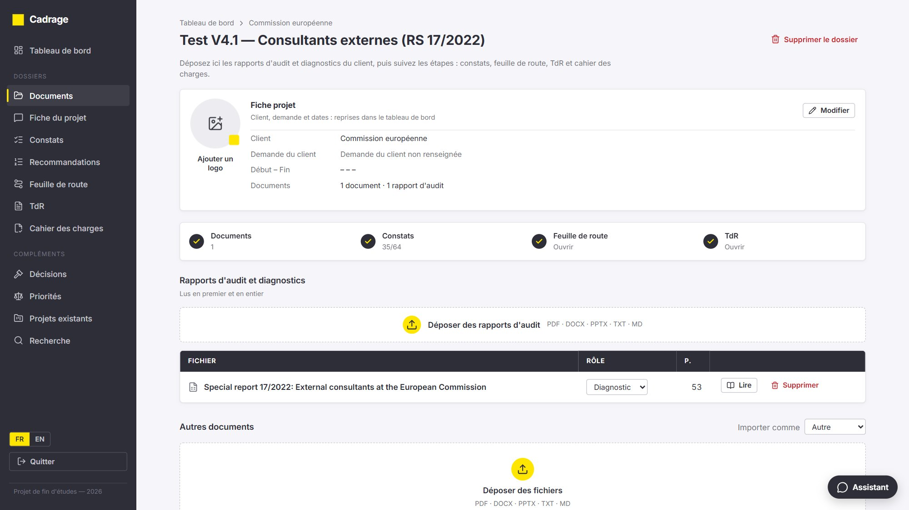
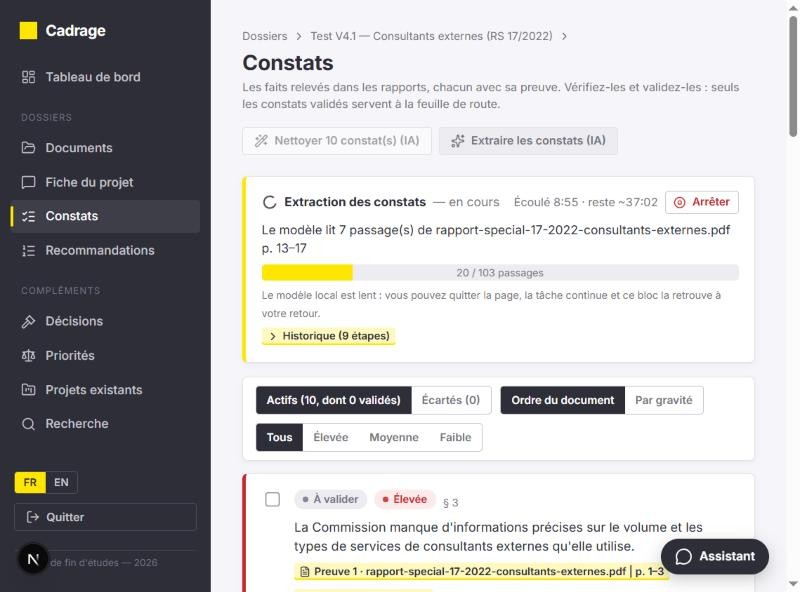
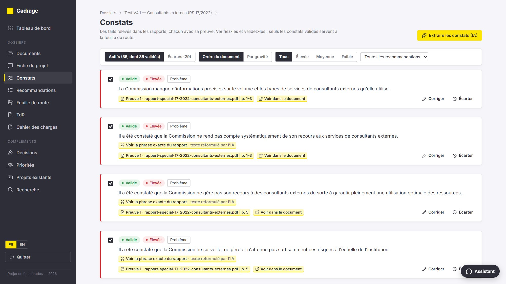
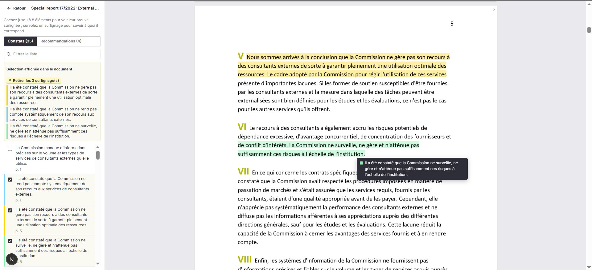
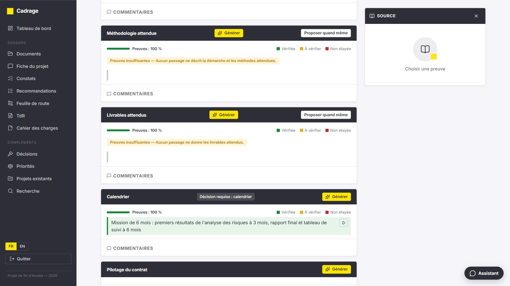
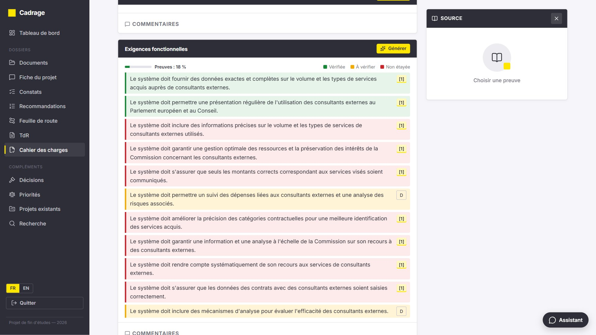
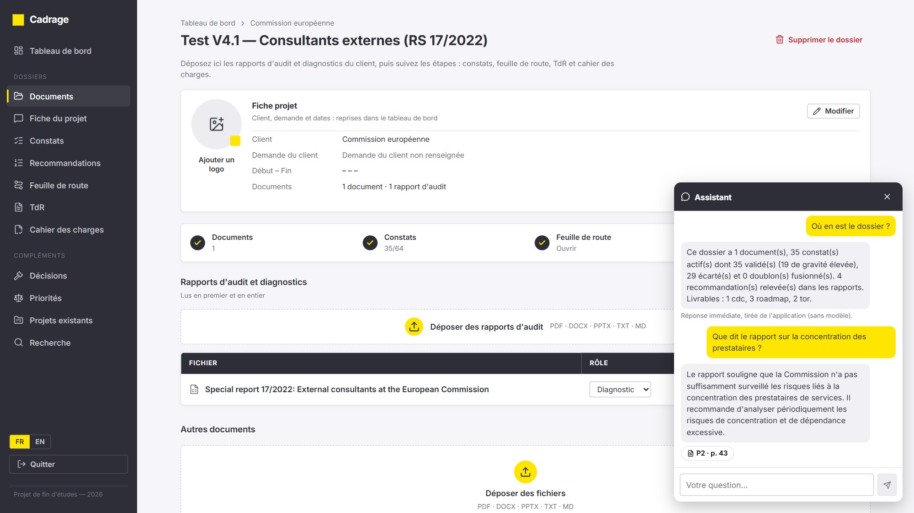

# 24 — Le parcours en images, relu par un expert

Ce document montre l'application **pour de vrai**, du rapport d'audit à la feuille de route et cahier des charges. Sous chaque capture :
**ce que fait l'application**, puis **la relecture d'un consultant** qui a tout vérifié contre le rapport : ce qui
est juste, ce qui est faux. Les erreurs sont gardées : elles servent à corriger le code et à préparer le prochain
entraînement du modèle ([doc 23 §4](23-versions-de-l-application.md)).

**Le document testé** : le rapport spécial 17/2022 de la Cour des comptes européenne, « Le recours de la Commission
européenne à des consultants externes ». C'est un document public (53 pages, licence CC BY 4.0). Il contient 4
recommandations officielles et une centaine de paragraphes numérotés.

**Le matériel** : un ordinateur portable avec un petit GPU de 4 Go. Le modèle tourne sur place, rien ne sort.

---

## 1. Le tableau de bord

**Ce qu'on fait** : on crée un dossier, ici « Test V4.1 », pour tester la dernière version.
**Relecture** : le compteur comptait d'abord aussi les phrases écartées ; corrigé pendant le test.

## 2. Le dossier et son rapport

**Ce qu'on fait** : on dépose le PDF. L'application le découpe en 103 passages et le prépare pour la recherche
(environ 3 min). Les étapes en haut montrent l'avancement.

## 3. L'IA lit le rapport, en direct

**Ce qu'on voit** : ce que fait le modèle, le nombre de passages lus, le temps écoulé et restant, un bouton Arrêter.
La lecture complète prend environ **36 minutes**. Les constats apparaissent au fur et à mesure.
*(Capture plus ancienne, prise dans une fenêtre plus petite.)*

## 4. Les constats : 35 gardés sur 64

**Ce qui s'est passé** :
- l'IA a relevé **64 phrases**, toutes copiées mot pour mot du rapport (c'est vérifié) ;
- **29 n'étaient pas des constats** : 8 phrases de méthode (« Nous avons examiné si… »), 2 descriptions de figure,
  17 phrases de contexte ou de règle, écartées automatiquement ; 2 écartées par le consultant ;
- les constats gardés sont **reformulés** en « Il a été constaté que… », la phrase exacte restant affichée ;
- le consultant a fait **6 corrections** : 2 reformulations remises à la phrase du rapport, 1 constat écarté à
  tort rétabli, 2 phrases écartées, 1 fusion de doublons annulée ;
- résultat : **35 constats validés**.

**Relecture** : tous les constats importants de la conclusion du rapport sont là, sauf un (« la diffusion des
résultats est fragmentée »). Environ **45 %** des phrases relevées n'étaient pas des constats : le nettoyage les
écarte. Environ **1 reformulation sur 20** change le sens : c'est pourquoi elles sont marquées « à relire ».
La **gravité** (élevée, moyenne, faible) est peu fiable : un même manque est « élevé » à un endroit, « faible » à un autre.

## 5. Les recommandations du rapport

**Ce qu'on voit** : les 4 recommandations, en entier : sous-points a), b), c), échéance (« D'ici à décembre 2023 »)
et paragraphes du rapport qui les justifient. Relevées par des règles, sans IA, en une seconde.
**Relecture** : comparé au rapport (pages 42 à 45), **tout est juste** : 4 recommandations sur 4, 11 sous-points
sur 11, échéances et paragraphes exacts.

## 6. Chaque preuve, surlignée dans le document

**Ce qu'on voit** : la recommandation n° 1 surlignée dans le PDF, à la bonne page. Au survol, une bulle dit à quoi
correspond le passage. On peut surligner jusqu'à 8 éléments à la fois.
**Relecture** : le surlignage suit les lignes du PDF, il déborde parfois un peu sur la phrase voisine.

**Le plus utile** : ici trois constats **reformulés par l'IA** sont surlignés à leur place dans le rapport (points V
et VI de la synthèse). L'expert voit d'un coup d'œil que chaque constat existe et que la reformulation garde le sens.

Le document testé, dans la visionneuse : rapport spécial 17/2022 de la Cour des comptes européenne
(© Union européenne, licence CC BY 4.0 ; le logo de la Cour, exclu de cette licence, n'est pas reproduit).

## 7. La feuille de route

**Ce qu'on voit** : chaque recommandation devient un **axe** (R1 à R4), chaque sous-point une **initiative**,
rangée dans une **vague** : 0-6 mois, 6-12 mois, 12-24 mois. Calcul en 20 secondes, sans IA.
**Relecture** : la structure suit exactement le rapport (11 initiatives pour 11 sous-points).

## 8. Pourquoi cette vague

**Ce qu'on voit** : chaque initiative dit d'où elle vient (« recommandation n° 2, point a), p. 43 ») et **pourquoi**
elle est dans sa vague. Boutons pour rédiger ses TdR ou son cahier des charges.
**Relecture** : **erreur de priorité** : la recommandation n° 1 (« compléter le cadre », la base de tout le reste)
part en vague 3, parce que l'IA a jugé « faibles » les constats qui la justifient. Un consultant la mettrait en vague 1.

## 9. Les termes de référence (TdR)

**Ce qu'on voit** : le calendrier, le profil et les critères, décidés par le consultant, sont repris **tels quels**.
Pour les autres sections, sans preuve, l'IA **refuse** au lieu d'inventer.
**Relecture** : refuser la **méthode** est juste (le rapport n'en parle pas). Refuser les **objectifs** et les
**livrables** est une erreur : la recommandation, donnée à l'IA, les contenait. Le « contexte » rédigé était aussi
hors sujet, avec une phrase abîmée par le PDF pourtant marquée « vérifiée ».

## 10. Le cahier des charges

**Ce qu'on voit** : les exigences proposées par l'IA, colorées selon leur preuve : vert vérifiée, orange à vérifier,
rouge non étayée.
**Relecture** : 5 exigences sur 11 sont justes ; 1 doublon, 1 qui n'est pas une exigence, 1 incohérente, et 2 qui
citent à tort une décision du consultant (« D »). C'est un **premier jet à reprendre**, et les couleurs le montrent.

## 11. L'assistant, sur toutes les pages

**Ce qu'on voit** : « Où en est le dossier ? » : réponse immédiate, tirée de l'application. « Que dit le rapport sur
la concentration des prestataires ? » : réponse du modèle avec sa source (p. 43), en un peu plus d'une minute.
**Relecture** : la réponse est juste et la source est la bonne page.

---

## En résumé

| Étape | Fiabilité observée |
|---|---|
| Recommandations | **exactes** (règles) |
| Constats | complets, phrases exactes ; beaucoup de bruit écarté ; gravité peu fiable |
| Reformulation | ≈ 1 erreur de sens sur 20, toujours à relire |
| Feuille de route | structure exacte ; priorités faussées par la gravité |
| TdR et cahier des charges | décisions exactes ; le reste refusé ou à reprendre |
| Assistant | réponses justes, avec leur source |

L'application **ne remplace pas le consultant** : elle prépare, montre ses preuves et signale ce qui est à relire.
Ce que le prochain entraînement doit apprendre (gravité ; objectifs, livrables et exigences tirés d'une
recommandation ; reformulation fidèle) est détaillé dans la [doc 23](23-versions-de-l-application.md).
