# 24 — Le parcours en images : d'un rapport d'audit au cahier des charges

> Test complet de la **V4.1** fait le 27-28/11/2026 comme un utilisateur, dans l'application réelle, sur un
> **nouveau dossier** et le rapport public **RS 17/2022 de la Cour des comptes européenne** (53 pages,
> « Recours aux consultants externes »). Sous chaque capture : ce que fait l'application, puis la **relecture
> d'un expert** (ce qui est juste, ce qui est faux). Les erreurs trouvées sont gardées : elles décident des
> corrections du code (V4.2) et du prochain entraînement (doc 23 §4).

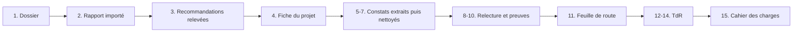

---

### 1. Le tableau de bord
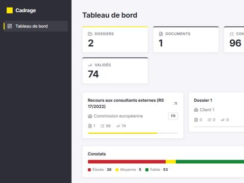

Les dossiers du cabinet ; « + Nouveau » crée un dossier (client, nom).
**Relecture** : le compteur « constats » comptait aussi les constats écartés et fusionnés (96 au lieu de 62
actifs) ; corrigé pendant le test. Après « Créer », l'application restait sur le tableau de bord : elle ouvre
maintenant le dossier créé.

⬇

### 2. Le rapport est importé
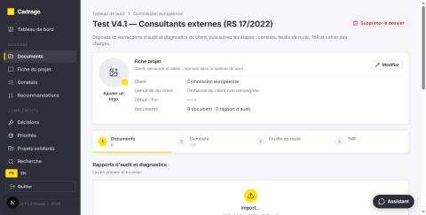

Le PDF est déposé dans « Rapports d'audit et diagnostics » : il est découpé en 103 passages et indexé pour la
recherche par le sens (≈ 3 min sur ce poste).
**Relecture** : la capture montre l'état d'avant correction (« Import… » sans rien d'autre) ; l'import affiche
maintenant ce qu'il fait et le temps écoulé.

⬇

### 3. Les recommandations du rapport, relevées en entier
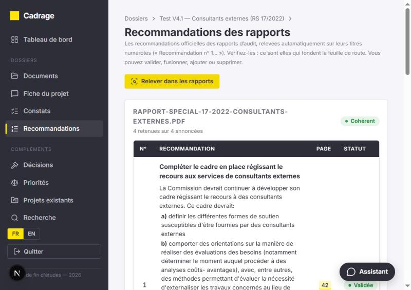

Par règles, sans modèle, en une seconde : titre, phrase d'introduction, sous-points a), b), c), échéance et
paragraphes cités. Le consultant valide.
**Relecture** : comparé au rapport (p. 42-45) : 4 recommandations sur 4, 11 sous-points sur 11, 4 échéances,
paragraphes cités exacts (18-26 et 24, 28-32 ; 34-36 et 38-56 ; 57-71 ; 72-84). **Aucune erreur.**

⬇

### 4. La fiche du projet

Secteur, périmètre, contraintes, parties prenantes et types de projet (ici « Services et externalisation » et
« Étude et conseil », qui ajoutent leurs sections aux TdR et au cahier des charges). Confirmée par le consultant.

⬇

### 5. L'IA lit le rapport, et on la suit en direct

Étape en cours (« Le modèle lit 7 passages… p. 13–17 »), avancement (20/103), temps écoulé et restant, bouton
Arrêter. Les constats apparaissent **au fil de l'eau**, avant la fin : chaque lot lu est enregistré.

⬇

### 6. L'historique de la lecture
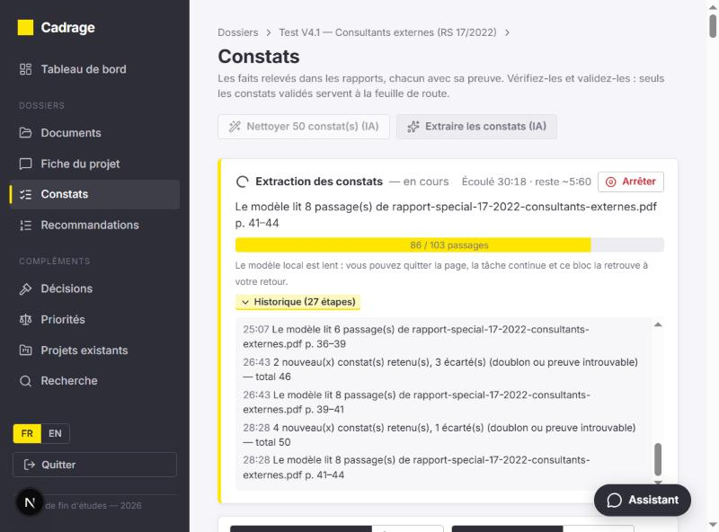

Chaque lot : pages lues, constats retenus, phrases écartées (doublon ou preuve introuvable). 103 passages en
≈ 36 min sur un GPU de 4 Go.
**Relecture** : 64 phrases relevées, toutes **copiées mot pour mot** du rapport (vérifié). Les constats clés de
la conclusion (§ 86 à 91) sont tous là. Manque : « la diffusion des résultats est fragmentée » (§ 90). La
**gravité** est incohérente : le même manque est « élevé » dans la synthèse et « faible » dans le corps du texte.

⬇

### 7. Le nettoyage : bruit écarté, doublons, reformulation
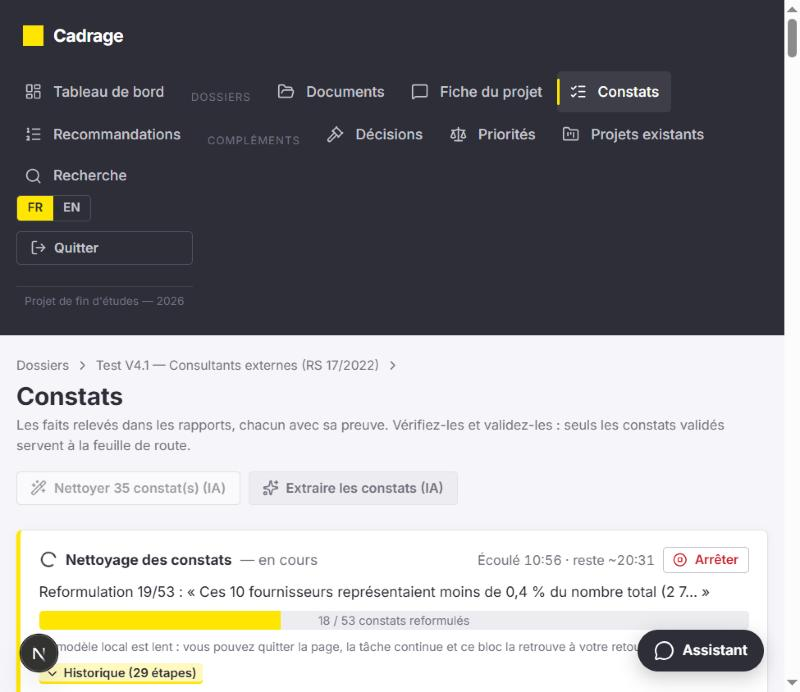

Phrases de méthode (« Nous avons examiné si… ») et de figure écartées ; doublons fusionnés ; chaque constat
reformulé en « Il a été constaté que… » avec garde-fous (fidélité par le sens, chiffres, nature).
**Relecture (53 constats)** : 36 reformulés par l'IA, 17 par une règle simple (garde-fous), 18 écartés.
Aucune invention de fait cette fois (le premier essai, sans garde-fous, en avait ≈ 5 sur 59). Erreurs restantes :
un glissement de sens (« manque d'informations » → « ne précise pas »), un **sens inversé** (n° 150, la
source du financement), une fusion fausse (deux phrases « lignes directrices… » bâties sur le même modèle), un
vrai constat écarté (« elles tendent à échapper à une supervision rigoureuse »), « cela » non résolu, une faute
de langue. Les défauts de règle (« Il a été constaté que nous avons observé… », « que au ») ont été corrigés.

⬇

### 8. La relecture par le consultant
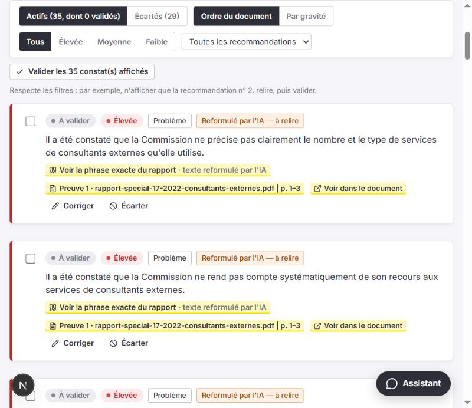

Chaque reformulation porte « Reformulé par l'IA — à relire » ; la phrase exacte du rapport est à un clic ;
« Valider les N constats affichés » suit les filtres.
**Relecture** : avant de valider, le consultant remet la phrase du rapport pour la reformulation fautive, écarte
deux phrases de contexte (intérêt du Parlement et des médias, cellule du tableau 6) : 35 constats validés.

⬇

### 9. Un constat écarté à tort se rétablit
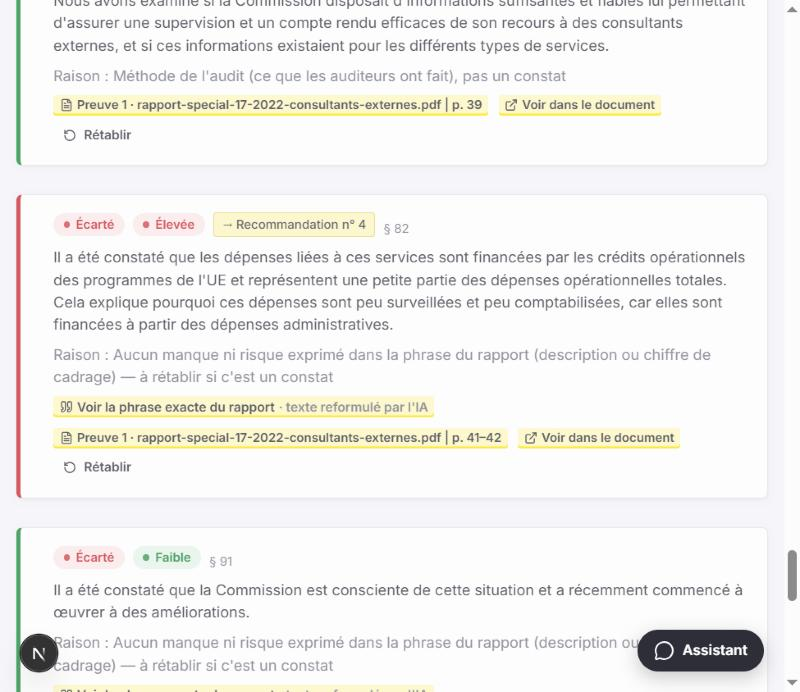

Écarté ne veut pas dire supprimé : la raison est affichée, « Rétablir » le remet ; « Défusionner » sépare deux
constats fusionnés à tort (testé sur la fusion fausse).

⬇

### 10. Les preuves surlignées dans le PDF
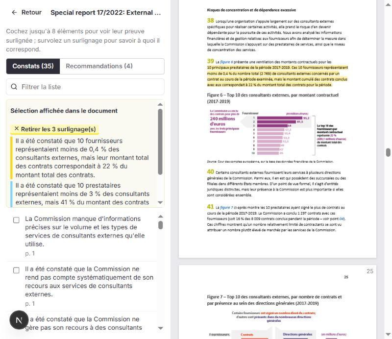

Le document s'ouvre dans l'application, sur la preuve, surlignée ; jusqu'à 8 constats à la fois, une couleur
chacun ; la sélection est rappelée à gauche.
**Relecture** : le surlignage suit les lignes du PDF : il déborde parfois sur la phrase voisine.

⬇

### 11. La feuille de route, fondée sur les recommandations
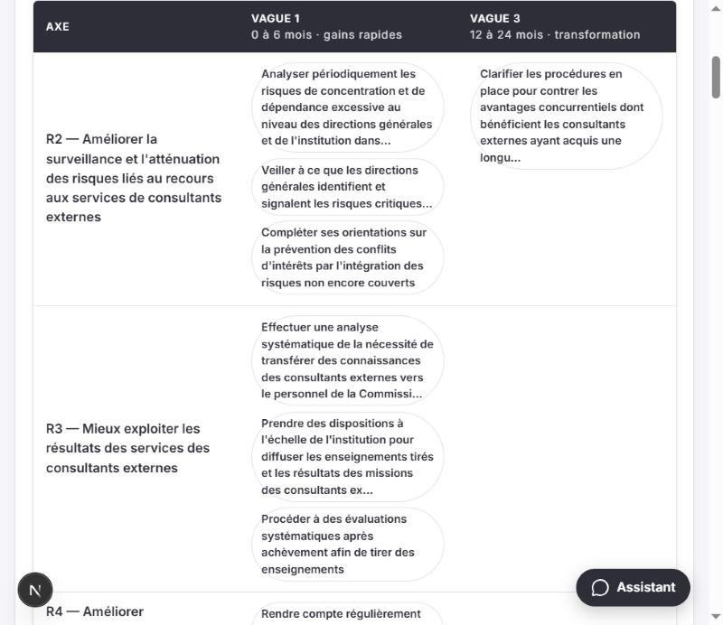

Une recommandation = un axe, un sous-point = une initiative, les constats liés comme justification ; vague
fixée par l'échéance du rapport, sinon par la gravité, avec la raison écrite (« Pourquoi cette vague : … »).
Calcul sans modèle : ≈ 20 s.
**Relecture** : structure fidèle au rapport (11 initiatives = 11 sous-points). Deux erreurs de logique de mon
code, corrigées : un sous-point sans constat passait devant un sous-point appuyé par des constats ; un titre
n'était pas une action. **Erreur de priorité restante** : toute la recommandation n° 1 (« compléter le cadre »,
la base des autres) part en vague 3, parce que le modèle a jugé « faibles » les constats qui la justifient ; un
consultant la mettrait en vague 1. La gravité est la première chose à entraîner.

⬇

### 12. Les TdR d'une initiative, rédigés section par section
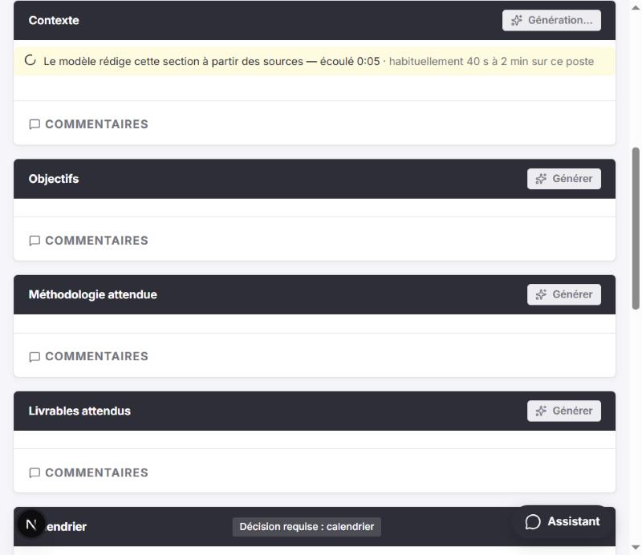

Depuis la feuille de route, « Rédiger les TdR » sur une initiative ; chaque section est rédigée à partir des
sources (40 s à 2 min), chaque phrase vérifiée.
**Relecture (Contexte)** : « Preuves : 100 % », mais une phrase est **abîmée** (une note de bas de page du PDF
collée au texte) et **acceptée** parce que copiée mot pour mot ; le contenu est **hors sujet** (orientations
sur les évaluations au lieu de la concentration des prestataires) ; le style recopie la voix des auditeurs
(« Nous avons constaté… ») au lieu de présenter le contexte d'une mission.

⬇

### 13. Les décisions humaines
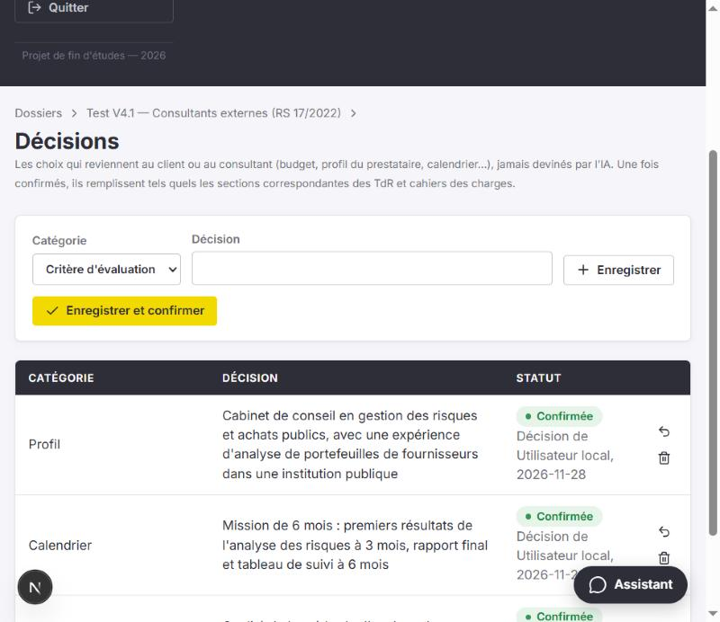

Profil du prestataire, calendrier, critères d'évaluation : saisis et confirmés par le consultant ; les sections
correspondantes des TdR les reprennent **telles quelles, instantanément, sans modèle**.

⬇

### 14. Ce que le modèle refuse d'écrire
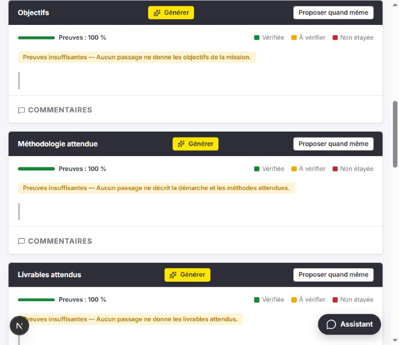

Objectifs, méthodologie, livrables : « Preuves insuffisantes ». « Proposer quand même » demande une proposition au
modèle de base, à relire.
**Relecture** : le refus de la **méthodologie** est juste (le rapport ne la décrit pas). Ceux des **objectifs**
et des **livrables** ne le sont pas : la recommandation 2 a) était transmise en première source et contient
l'objectif ; le modèle entraîné ne sait pas transformer une recommandation en objectif de mission. La proposition
du modèle de base : 8 objectifs dont 3 répétitions et 2 hors périmètre (un consultant en écrirait 2 ou 3).

⬇

### 15. Le cahier des charges : exigences proposées, vérifiées une à une
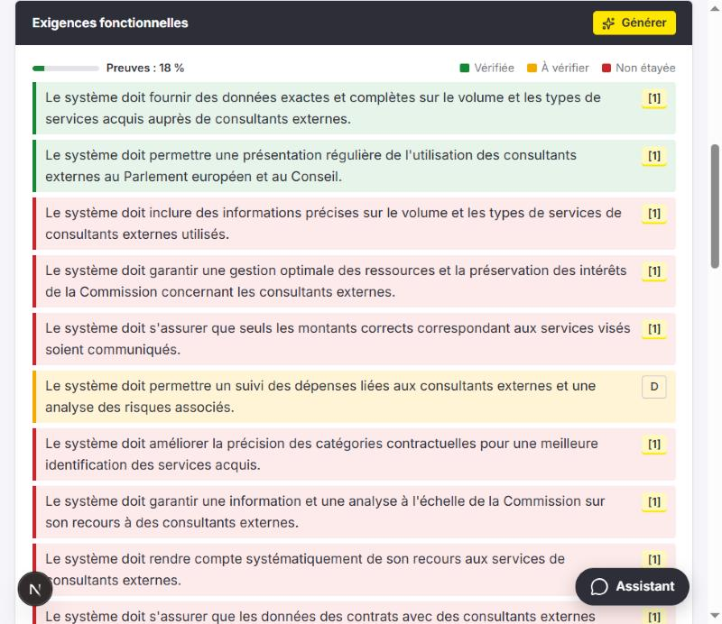

Pour l'initiative « Rendre compte régulièrement… » (recommandation 4). Le modèle entraîné refuse ; le modèle de
base propose 11 exigences ; le vérificateur en marque 9 en rouge « non étayée ».
**Relecture** : 5 exigences justes et ancrées dans le rapport, 1 doublon, 1 qui n'est pas une exigence, 1
incohérente, et **2 qui citent à tort une décision du consultant** (« D ») comme source. Un consultant écrirait
des exigences numérotées et testables (EF-01 registre central des contrats de conseil, EF-02 contrôle de la
catégorie à la saisie, EF-03 rapport annuel par DG et type de service).

---

## Bilan honnête

| Étape | Fiabilité observée | Qui fait le travail |
|---|---|---|
| Recommandations (relevé complet) | **exacte** | règles |
| Extraction des constats | bonne couverture, phrases exactes ; gravité peu fiable | modèle entraîné (V4) + vérificateur |
| Nettoyage / reformulation | ≈ 1 erreur de sens sur 20 avec garde-fous ; à relire | modèle de base + garde-fous |
| Feuille de route | structure exacte ; priorités faussées par la gravité | règles (sans modèle) |
| TdR et cahier des charges | sections de décision exactes ; sections rédigées souvent refusées ou à reprendre | modèle entraîné, proposition par le modèle de base |

L'application **ne remplace pas** le consultant : elle prépare, cite et signale ce qui est à relire. Les
erreurs relevées ici fixent le prochain entraînement : gravité des constats ; objectifs, livrables et exigences
tirés d'une recommandation ; contexte rédigé dans le style d'un TdR (doc 23 §4).
